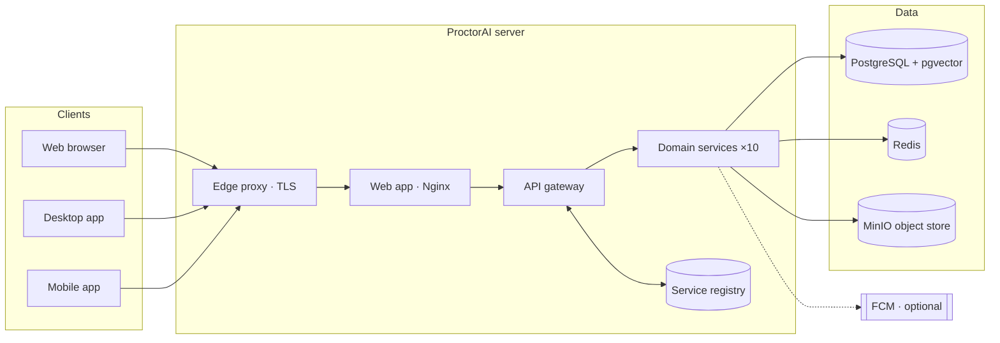

## Introduction

### Purpose

This Software Requirements Specification (SRS) defines what ProctorAI must do and the qualities it must have. It is the reference for design, implementation, testing and acceptance of ProctorAI version 1.1.0. It follows the structure recommended by IEEE 830 / ISO/IEC/IEEE 29148.

### Product scope

ProctorAI is an AI-assisted complaint, identity and access-management platform for educational institutions and similar organisations. It lets an institution:

- manage users, departments and roles with a fine-grained permission model enforced inside the database;
- receive, assign, process and resolve complaints with a complete audit history;
- identify people on-premises with face recognition (detection, enrollment and live recognition);
- notify people in real time on the web, desktop and mobile;
- extend core entities with administrator-defined custom fields;
- observe the health of every service, the database, the cache and the host.

The product ships as a set of containerised microservices with a web application. The same web application is also packaged as native desktop (Windows, macOS, Linux) and mobile (Android, iOS) apps.

### Definitions, acronyms and abbreviations

| Term | Meaning |
|---|---|
| RBAC | Role-based access control |
| RLS | PostgreSQL Row-Level Security: policies that filter rows per database session |
| Scope | The breadth of a permission: `own`, `department` or `all` |
| Entity | A protected resource type, for example `complaints` or `face_enrollments` |
| JWT | JSON Web Token, used as the short-lived access token |
| Refresh token | Long-lived opaque token used to obtain new access tokens; rotated on every use |
| SSE | Server-Sent Events, a one-way streaming channel used for live updates |
| FCM | Firebase Cloud Messaging, used for optional mobile push notifications |
| SCRFD / ArcFace | Face detection and face embedding neural network models |
| pgvector | PostgreSQL extension for vector similarity search |
| Subject | A person a complaint is about (`student` plus optional additional subjects) |
| Reporter | The user who raised a complaint (`raised_by`) |

### References

- ProctorAI `README.md`, `GUIDE.md`, `backend/README.md`, `backend/face-service/README.md`
- Flyway migrations in `backend/db-schema/src/main/resources/db/migration/`
- Postman collection in `backend/postman/`
- IEEE Std 830-1998 and ISO/IEC/IEEE 29148:2018

### Document overview

Section 2 describes the product in general terms. Section 3 lists functional requirements by feature area. Section 4 defines external interfaces. Section 5 sets non-functional requirements. Section 6 records constraints, assumptions and dependencies. Section 7 traces requirements to their verification.

## Overall description

### Product perspective

ProctorAI is a self-contained system. It depends only on open-source infrastructure that ships with it: PostgreSQL 16 with pgvector, Redis 7.4, MinIO (S3-compatible storage) and the Caddy edge proxy. Optionally it connects to Firebase Cloud Messaging for push notifications. Face recognition runs entirely on the server, with no external AI API.

### Product functions

| Area | Summary |
|---|---|
| Authentication | Sign in with email and password, token refresh with rotation, sign out of one or all sessions, brute-force protection |
| Users | Create, edit, disable and delete users; bulk create; CSV/Excel import with templates |
| Departments | Create and manage departments and their members |
| Roles & permissions | Define roles with a level and a permission set over entity × action × scope |
| Complaints | File, triage, assign, change status, resolve or reject, comment (public and internal), attach files and evidence, view history |
| Dashboard | Totals, status and priority breakdowns, 7-day trends, department load, overdue and critical counts |
| Face recognition | Enroll faces, recognise faces in uploads or from a live camera, bulk enroll, enrollment lock, audit log |
| Notifications | In-app inbox, real-time stream, preferences, device registration, broadcast sending, FCM integration and delivery log |
| Custom fields | Administrator-defined typed fields on users, departments, roles and complaints |
| System monitor | Live host, service, database, cache and storage metrics, with history and issues |
| Native apps | Desktop and mobile apps with notifications, deep links, camera and native downloads |

### User classes and characteristics

| User class | Description | Typical default role |
|---|---|---|
| System administrator | Installs, configures and operates the platform; unrestricted access | `system_admin` |
| Administrator | Manages users, roles, departments, complaints and settings; unrestricted access | `admin` |
| Staff / teacher | Handles complaints of their departments; reads department users | `teacher` (level 20) |
| Student / member | Files and follows their own complaints; manages own profile and face enrollment | `student` (level 50) |
| Operator / DevOps | Deploys, backs up, monitors and upgrades the stack | Server access, not an app role |
| Integrator | Calls the REST API from other systems | Any role with the needed permissions |

A lower role **level** means more seniority. Level 0 is reserved for superuser roles.

### Operating environment

| Component | Requirement |
|---|---|
| Server OS | 64-bit Linux (x86_64) with Docker 25+ and Docker Compose 2.21+ |
| Server hardware | Minimum 8 GB RAM and 20 GB free disk; 16 GB RAM recommended |
| Web clients | Chrome/Edge 111+, Firefox 128+, Safari 16.4+ |
| Desktop apps | Windows 10/11 (x64), macOS 13+ (universal), Linux with WebKitGTK 4.1 |
| Mobile apps | Android 8.0 (API 26)+, iOS 16.4+ |
| Network | Public IPv4 address; inbound TCP 80, TCP 443 and UDP 443 |

### Design and implementation constraints

- Backend: Java 21, Spring Boot 3.5, Spring WebFlux (reactive, non-blocking), R2DBC, Spring Cloud Gateway and Eureka.
- Frontend: React 19, TypeScript, Vite, Tailwind CSS 4, shadcn/ui, TanStack Router and Query; native shells built with Tauri 2.
- Authorization must be enforced in PostgreSQL through RLS policies and security functions, not only in service code.
- Database changes must be delivered as forward-only Flyway migrations. A released migration must never be edited.
- All runtime components must run as Docker containers orchestrated by Docker Compose.
- Face models originate from InsightFace's buffalo_l pack, which is licensed for non-commercial research use. Commercial distribution requires a license review.

### Assumptions and dependencies

- The institution controls a domain name and can create DNS A records.
- Let's Encrypt (or ZeroSSL as fallback) is reachable for TLS certificates.
- Docker Hub is reachable when deploying the published images.
- FCM push requires the institution's own Firebase service account.

## Functional requirements

Requirements use the keywords **shall** (mandatory) and **should** (recommended). Each requirement has an identifier for traceability.

### Authentication and sessions (AUTH)

| ID | Requirement |
|---|---|
| AUTH-01 | The system shall authenticate users with email and password via `POST /auth/login`. |
| AUTH-02 | The system shall issue a signed JWT access token (default lifetime 15 minutes) and an opaque refresh token (default lifetime 30 days). |
| AUTH-03 | For browsers, tokens shall be delivered as `HttpOnly` cookies (`token` on `/`, `refresh_token` on `/auth`), `Secure` behind HTTPS and `SameSite=Lax`. |
| AUTH-04 | Native apps shall be able to receive tokens in the response body by sending `X-Token-Delivery: body`. |
| AUTH-05 | Each refresh shall rotate the refresh token. Reuse of an already rotated token shall revoke the whole token family. |
| AUTH-06 | Users shall be able to sign out of the current session (`/auth/logout`) and of all sessions (`/auth/logout-all`). |
| AUTH-07 | The gateway shall rate-limit sign-in attempts per client IP (default burst of 10 attempts, then 20 per minute). |
| AUTH-08 | The system shall lock an account for a configurable period after a configurable number of consecutive failed sign-ins (defaults: 10 failures, 15 minutes). |
| AUTH-09 | Disabled users shall not be able to sign in. |
| AUTH-10 | Revoking or disabling a user shall revoke their refresh tokens. |

### Users (USR)

| ID | Requirement |
|---|---|
| USR-01 | Authorised users shall list users with paging (max 100 per page), sorting and filtering, including custom-field filters. |
| USR-02 | Authorised users shall create a user with name, unique email, password (8–200 characters), roles, departments, custom fields, `enabled` and `verified`. |
| USR-03 | Authorised users shall update (`PUT`) or partially update (`PATCH`) users, and delete one or many users. |
| USR-04 | The system shall support bulk creation from JSON and import from CSV or Excel with a downloadable template, reporting progress and per-row results. |
| USR-05 | Every user shall be able to read their own profile, roles, permissions and departments (`/users/me/*`). |
| USR-06 | A user shall manage only themselves and more junior users (higher role level), unless they are a superuser. Peers on the same or a parallel role require the explicit `same_role_peers` or `parallel_role_peers` permissions. |
| USR-07 | The system shall prevent deleting, disabling or removing the role of the last system administrator, and users shall not change their own roles or enable/disable their own account. |
| USR-08 | A user shall never grant a permission they do not hold themselves (`PERMISSION_ESCALATION`). |

### Departments (DEP)

| ID | Requirement |
|---|---|
| DEP-01 | Authorised users shall create, read, update, patch and delete departments with a unique `code`. |
| DEP-02 | Authorised users shall add and remove department members in bulk. |
| DEP-03 | Department membership shall drive `department`-scoped permissions. |

### Roles and permissions (ROL)

| ID | Requirement |
|---|---|
| ROL-01 | The system shall define permissions as a combination of entity, action (`read`, `write`, `update`, `delete`) and scope (`own`, `department`, `all`). |
| ROL-02 | Authorised users shall create roles with a name, description, level (1–1000), `revealIdentity` flag, custom fields and permissions. |
| ROL-03 | Authorised users shall replace, add or remove a role's permissions. |
| ROL-04 | System roles (`system_admin`, `admin`) shall not be deletable or downgradable. |
| ROL-05 | The permission catalogue shall be readable to build the permission matrix in the UI. |

### Complaints (CMP)

| ID | Requirement |
|---|---|
| CMP-01 | A user shall file a complaint with title (≤200), description (≤5000), optional category (default `general`), priority (`low`, `medium` default, `high`, `urgent`), department, student and up to 50 additional subjects and custom fields. |
| CMP-02 | Complaints filed by a user without `department` or `all` write scope shall always start as `pending`. |
| CMP-03 | Staff shall change status among `pending`, `reviewed`, `resolved` and `rejected`, with an optional note and resolution. Resolving or rejecting shall set `resolved_at`. |
| CMP-04 | Staff shall assign a complaint to a user. |
| CMP-05 | A reporter without staff scope shall only edit their complaint while it is `pending`; after that it is locked (`COMPLAINT_LOCKED`). |
| CMP-06 | Every status change shall be recorded in an immutable history with actor, from/to status, note and time. |
| CMP-07 | Users shall add comments (≤4000 characters). Staff may mark comments `internal`, which hides them from the reporter and subjects. |
| CMP-08 | Users shall attach files via presigned upload URLs, confirm the upload, list files and obtain time-limited download URLs. |
| CMP-09 | The reporter's identity shall be hidden from people without `revealIdentity` unless the complaint sets `revealReporter`. |
| CMP-10 | Users shall list, filter, sort and page complaints within their permission scope. |
| CMP-11 | The system shall provide dashboard statistics (`/complaints/stats`) covering totals, status, priority, open, assigned to me, overdue, critical open, 7-day trends, average resolution time and department load. |
| CMP-12 | Parties to a complaint shall be notified of creation, assignment, status changes and comments. |

### Face recognition (FACE)

| ID | Requirement |
|---|---|
| FACE-01 | The system shall detect faces with SCRFD-10G and compute 512-dimensional ArcFace embeddings locally with ONNX Runtime. |
| FACE-02 | Authorised users shall enroll a user's face from a base64 image (largest face is used). |
| FACE-03 | Authorised users shall recognise all faces in an uploaded image or a live camera frame and receive an annotated image with bounding boxes and matches. |
| FACE-04 | A face shall be considered a match only when cosine similarity is at or above `FACE_MATCH_THRESHOLD`. |
| FACE-05 | Matches outside the caller's `users` read scope shall be reported as not matched, so identities never leak. |
| FACE-06 | Self-enrollment shall be capped (`FACE_SELF_ENROLL_LIMIT`, default 1). A privileged user may unlock or re-enroll, which resets the counter. |
| FACE-07 | Authorised users shall bulk-enroll faces from an uploaded file using a template. |
| FACE-08 | Every recognition, enrollment, replacement, removal, unlock and bulk import shall be written to the face audit log. |
| FACE-09 | Images larger than `FACE_MAX_IMAGE_BYTES` (default 8 MB) shall be rejected. |

### Notifications (NOT)

| ID | Requirement |
|---|---|
| NOT-01 | Users shall have a paged notification inbox with unread count, mark-read, mark-all-read and delete. |
| NOT-02 | The system shall stream new notifications in real time over SSE (`/notifications/stream`). |
| NOT-03 | Users shall set preferences: push on/off, real-time on/off, muted notification types. |
| NOT-04 | Native apps shall register and remove push devices (`android`, `ios`, `web`). |
| NOT-05 | Authorised users shall send notifications to users, roles and departments (up to 1000 users, 100 roles, 100 departments). |
| NOT-06 | Administrators shall configure FCM with an encrypted service-account secret, test it, and view delivery logs and statistics. |

### Custom fields (CF)

| ID | Requirement |
|---|---|
| CF-01 | Administrators shall define fields for `users`, `departments`, `roles` or `complaints` with a key (lower snake_case, ≤50), label, help text and type (`text`, `number`, `bool`, `date`, `select`, `multi_select`). |
| CF-02 | Fields shall support required, options, default, min/max, max length, regex pattern, sort order and active flag. |
| CF-03 | Fields may apply only to a role or a department; `/custom-fields/applicable` shall return the fields that apply. |
| CF-04 | Values shall be validated on every write of the owning entity. |
| CF-05 | List endpoints shall filter on custom fields with the `cf.<key>` syntax. |

### System monitor (MON)

| ID | Requirement |
|---|---|
| MON-01 | Users with `system_monitor:read:all` shall view a live overview of host CPU, memory, disks, network, per-service health and resource use, database, Redis and storage statistics. |
| MON-02 | The overview shall be streamed over SSE and include short-term history and detected issues. |

### Native applications (APP)

| ID | Requirement |
|---|---|
| APP-01 | Desktop and mobile apps shall offer the same features as the web app against any ProctorAI server. |
| APP-02 | The server address shall be configurable at build time (`VITE_SERVER_URL`) or entered at sign-in. |
| APP-03 | Apps shall show system notifications, support `proctorai://` deep links, use the device camera for face recognition and use native save dialogs. |

## External interface requirements

### User interfaces

- Responsive web UI with light and dark themes, a command palette, and layouts that respect safe areas on phones.
- Primary screens: Sign in, Dashboard, Complaints (list, new, detail), Users, Departments, Roles & access, Custom fields, Faces, Notifications, Notification admin, System monitor, Profile.
- Navigation and actions shall be shown only when the user's permissions allow them.

### Software interfaces

| Interface | Protocol | Notes |
|---|---|---|
| REST API | HTTPS/JSON via the gateway, under `/api` behind the web domain | See API Handbook PAI-API-003 |
| Live streams | SSE (`text/event-stream`) | Notifications, user events, system monitor, job progress |
| Object storage | S3 API via presigned URLs on the files domain | Upload with `PUT`, download with `GET` |
| Database | PostgreSQL wire protocol (R2DBC/JDBC), internal only | Not exposed outside the Docker network |
| Push | Firebase Cloud Messaging HTTP v1 | Optional |
| Metrics | Prometheus text format on `/actuator/prometheus`, internal only | |

### Communication interfaces

All public traffic uses HTTPS (HTTP/1.1, HTTP/2 and HTTP/3) once DNS is configured, with HSTS. Plain HTTP is used only during the IP-address bootstrap stage before DNS is ready.

## Non-functional requirements

### Performance

| ID | Requirement |
|---|---|
| PERF-01 | Services shall be non-blocking (WebFlux and R2DBC) to sustain concurrent requests with small thread pools. |
| PERF-02 | List endpoints shall be paginated with a maximum page size of 100. |
| PERF-03 | Interactive API calls should complete in under 300 ms at the 95th percentile on recommended hardware, excluding face recognition. |
| PERF-04 | Face recognition of a single 640-pixel image should complete in under 2 seconds on a 4-core server. |
| PERF-05 | Uploads up to 250 MB shall be supported through presigned URLs; web requests are capped at 300 MB. |

### Security

| ID | Requirement |
|---|---|
| SEC-01 | Every data access shall pass PostgreSQL RLS policies bound to the caller's identity (`auth.uid`). |
| SEC-02 | Services shall connect with least-privilege database roles (`authenticator`, `proctor`), never the owner. |
| SEC-03 | Passwords shall be stored as bcrypt hashes; refresh tokens shall be stored only as hashes. |
| SEC-04 | JWT secrets shall be at least 32 bytes; the registry password shall be at least 32 characters. |
| SEC-05 | Production containers shall run read-only, drop all Linux capabilities, use `no-new-privileges` and have memory limits. |
| SEC-06 | CORS shall allow only managed origins; storage and registry origins shall never be allowed. |
| SEC-07 | The registry dashboard and MinIO console shall never be exposed over plain HTTP. |
| SEC-08 | FCM credentials shall be encrypted at rest with `NOTIFICATION_SECRET_KEY`. |

### Reliability and availability

| ID | Requirement |
|---|---|
| REL-01 | Every service shall expose a health endpoint, and Compose shall start services in dependency order using health checks. |
| REL-02 | Containers shall restart automatically unless stopped (`restart: unless-stopped`). |
| REL-03 | Database migrations shall complete before any service starts; a failed migration shall stop startup. |
| REL-04 | Data shall survive container recreation through named volumes. |
| REL-05 | The target availability for a single-server deployment is 99.5 % per month, excluding planned maintenance. |

### Maintainability and portability

- Shared concerns live in `common-*` libraries; each service owns one bounded context.
- A single multi-stage Dockerfile builds every backend image.
- The stack runs on any Linux x86_64 host with Docker; developers can run it on macOS and Windows with Docker Desktop.

### Usability and accessibility

- The UI should meet WCAG 2.1 AA contrast in both themes.
- All destructive actions shall require confirmation.
- Errors shall be shown with the human-readable `message` returned by the API.

### Observability

- Logs shall be JSON in production with rotation (10 MB × 5 files per container).
- Logs shall carry a trace ID that follows a request across services.
- Metrics shall be available in Prometheus format inside the Docker network.

## Constraints, assumptions and risks

| Type | Item | Mitigation |
|---|---|---|
| Licence | InsightFace buffalo_l models are for non-commercial research use | Review licensing or replace models before commercial use |
| Single host | The reference deployment runs on one server | Scale vertically; see Architecture Document for scale-out options |
| Certificates | Let's Encrypt rate limits | Avoid repeated purges of production |
| Secrets | Losing the env file prevents reusing existing data | Back up the env file securely (see PAI-BDR-008) |
| Biometrics | Face data is sensitive personal data | Obtain consent, restrict permissions, audit every access |

## Verification and traceability

| Requirement group | Verified by |
|---|---|
| AUTH-01…10 | `AuthFlowIntegrationTest`, `LoginRateLimitIntegrationTest`, `JwtTokenServiceTest`, Postman collection |
| SEC-01, SEC-02, ROL-* | `RowLevelSecurityTest`, `MigrationTest` |
| REL-03 | `MigrationTest`, `DbMigratorApplicationTest` |
| Gateway client address | `ClientAddressFilterTest`, `ClientAddressResolverTest` |
| USR, DEP, CMP, FACE, NOT, CF, MON | Postman collection and manual acceptance test (User & Admin Manual, PAI-USR-013) |

### Acceptance criteria

1. A fresh server reaches a healthy state with `docker/setup.sh` and serves HTTPS on the configured domains.
2. The administrator can sign in with the one-time password and change it.
3. A student can file a complaint, a teacher of the same department can process it, and every status change appears in history and as a notification.
4. A user enrolled with face recognition is matched in a new photo, and the event appears in the face audit log.
5. `./gradlew build` passes in full.
