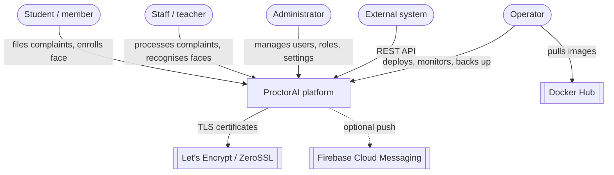
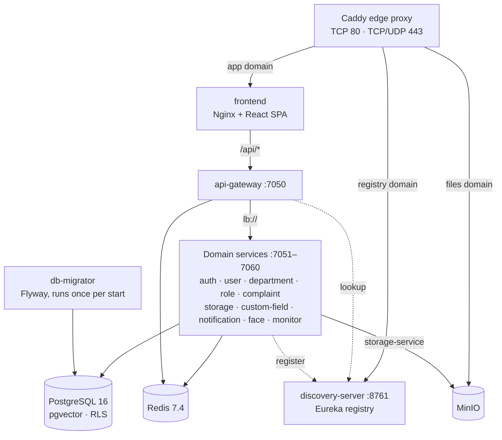
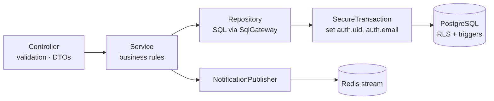
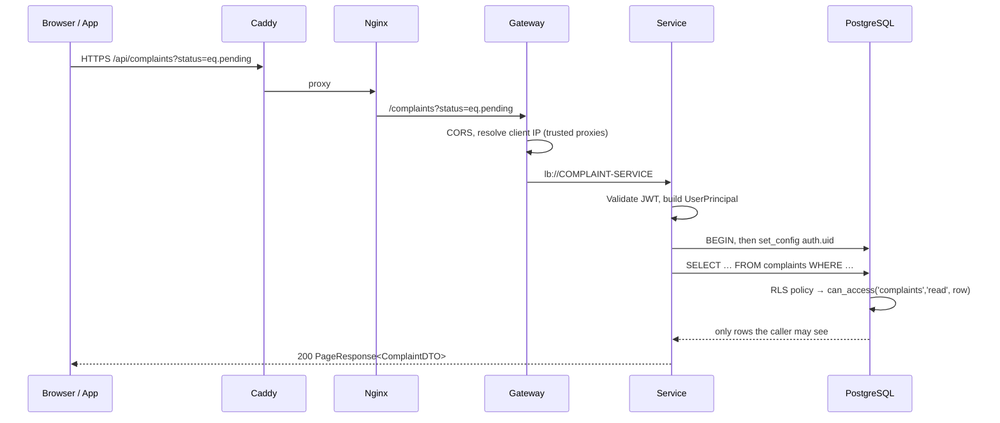
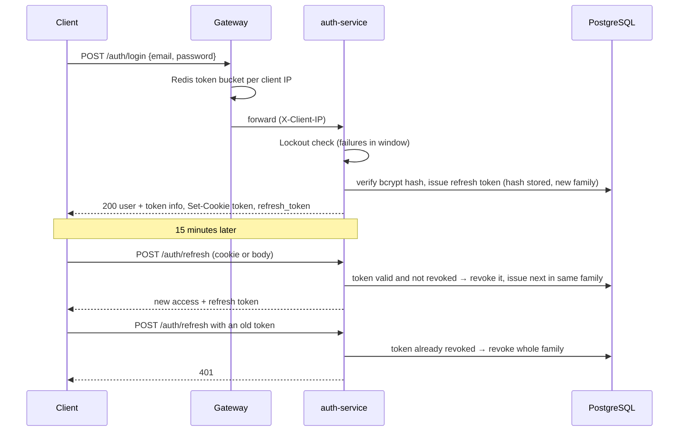
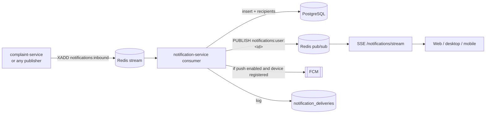
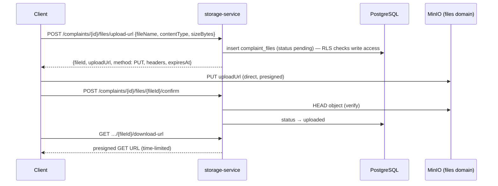
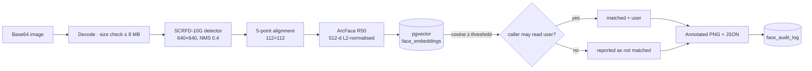
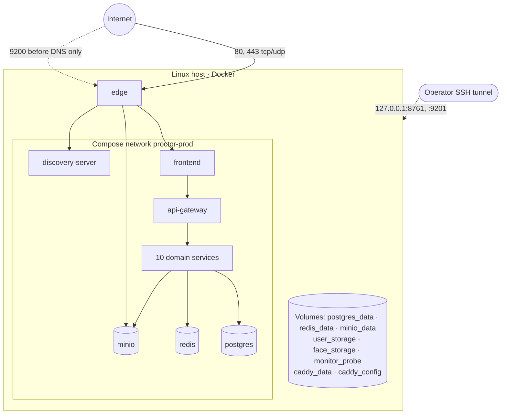

## Overview

ProctorAI is a reactive microservice system. A Spring Cloud Gateway routes every API call to one of ten domain services that are registered in a Eureka service registry. All services share one PostgreSQL 16 database (with pgvector), where authorization is enforced by Row-Level Security (RLS). Redis carries rate-limit buckets, notification streams, real-time fan-out, job progress and monitoring samples. MinIO stores uploaded files. A Caddy edge proxy terminates TLS in production.

This document follows the C4 model: system context, then containers, then components. It ends with cross-cutting concerns and recorded architecture decisions.

## System context

## Container view

### Containers and responsibilities

| Container | Technology | Responsibility | Gateway path |
|---|---|---|---|
| `edge` | Caddy 2.11 | TLS (Let's Encrypt, ZeroSSL fallback), HTTP/3, HSTS, security headers, routing by domain | — |
| `frontend` | Nginx + React 19 SPA | Serves the web app, proxies `/api/` to the gateway, blocks `/api/actuator/` | — |
| `api-gateway` | Spring Cloud Gateway | Routing via `lb://`, CORS, login rate limit, client IP resolution | — |
| `discovery-server` | Netflix Eureka | Service registry protected by HTTP Basic auth | — |
| `auth-service` | WebFlux + R2DBC | Login, refresh rotation, logout, lockout | `/auth/**` |
| `user-service` | WebFlux + R2DBC | Users, profile, bulk import, user event stream | `/users/**` |
| `department-service` | WebFlux + R2DBC | Departments and members | `/departments/**` |
| `role-service` | WebFlux + R2DBC | Roles, permission catalogue and matrix | `/roles/**` |
| `complaint-service` | WebFlux + R2DBC | Complaints, comments, assignment, status, history, dashboard stats | `/complaints/**` |
| `storage-service` | WebFlux + AWS SDK | Presigned uploads/downloads, file confirmation, stale upload purge | `/complaints/*/files/**` |
| `custom-field-service` | WebFlux + R2DBC | Custom field definitions | `/custom-fields/**` |
| `notification-service` | WebFlux + Redis | Inbox, SSE stream, preferences, devices, FCM, deliveries | `/notifications/**` |
| `face-service` | WebFlux + ONNX Runtime + Spring AI | Detection, embedding, enrollment, recognition, audit | `/faces/**` |
| `monitor-service` | WebFlux + OSHI | Host, service, DB, Redis and storage metrics | `/system/**` |
| `db-migrator` | Spring Boot + Flyway | Applies migrations, sets role passwords, then exits | — |
| `postgres` | PostgreSQL 16 + pgvector | System of record, RLS, vector index | — |
| `redis` | Redis 7.4 (AOF on) | Rate limits, streams, pub/sub, progress, monitoring samples | — |
| `minio` / `minio-init` | MinIO | Object storage; init creates bucket, policy and app user | — |

## Component view

### Shared libraries

Every domain service is assembled from the same building blocks:

| Library | Key components |
|---|---|
| `common-lib` | DTOs (`UserDTO`, `PageResponse`, `ApiError`…), enums (`EntityType`, `PermissionScope`…), typed exceptions mapped to HTTP status |
| `common-security` | `JwtAuthenticationWebFilter`, `JwtTokenService` (HMAC, secret ≥ 32 bytes), `TokenExtractor` (cookie `token` or `Authorization: Bearer`), `CurrentUser`, `BcryptPasswordHasher`, `GlobalExceptionHandler` |
| `common-persistence` | `SqlGateway` over R2DBC, `RlsTransaction` / `SecureTransaction`, `SearchQueryParser` (filter DSL), `PagedQueryRunner`, `PersistenceExceptionHandler` (SQLSTATE → HTTP), `DatabaseRoleGuard` |
| `common-storage` | `FileStorage` for temporary job files and `TemporaryFileSweeper` |
| `common-customfields` | Definition reader, validator and value store used by services that own extendable entities |
| `common-notifications` | `NotificationPublisher` (Redis stream), `ProgressBroker` (job progress) |
| `common-monitoring` | `InstanceSampler` / `InstanceReporter` publishing JVM and request metrics to Redis every 2 s |

### Layering inside a service

Controllers are thin. Services hold the workflow. Repositories issue explicit SQL through `SqlGateway`. Every request-scoped query runs inside a transaction that first sets `auth.uid` and `auth.email`, so RLS policies and triggers see the caller.

## Key flows

### Request and authorization flow

### Sign-in and token rotation

### Notification flow

Recipients are resolved in the database (`resolve_notification_recipients`) from user, role and department targets. Preferences (`push_enabled`, `realtime_enabled`, `muted_types`) are applied per user before delivery. Every channel attempt is logged as `sent`, `failed` or `skipped`.

### File upload flow

Unconfirmed uploads are purged by `purge_stale_uploads`. File bytes never pass through the API services.

### Face recognition flow

### System monitor flow

Each service runs `InstanceReporter`, which writes a JVM and request sample to Redis key `monitor:instance:<id>` every 2 seconds with a 10-second TTL. `monitor-service` combines those samples with the Eureka registry, host metrics (CPU, memory, disks, network), PostgreSQL statistics functions, Redis `INFO` and storage usage into a `SystemSnapshot`, keeps a short history, derives issues, and streams it over SSE at `/system/stream`.

## Deployment view

| Domain | Served by | Purpose |
|---|---|---|
| `app.<domain>` | Caddy → frontend → gateway | Web app and API (`/api`) |
| `files.<domain>` | Caddy → MinIO | Presigned uploads and downloads |
| `registry.<domain>` | Caddy → discovery-server (dashboard only) | Eureka dashboard, behind Basic auth |

### Resource budget (production defaults)

| Container | Memory limit |
|---|---|
| Each domain service and gateway | 768 MB |
| `face-service` | 2560 MB |
| `discovery-server`, `monitor-service` | 512 MB |
| `db-migrator` | 384 MB |
| `edge` | 256 MB |
| `frontend` | 128 MB |

The JVM uses G1 with `MaxRAMPercentage=60` and exits on out-of-memory so Docker restarts it cleanly.

## Cross-cutting concerns

| Concern | Approach |
|---|---|
| Authentication | Stateless JWT in an `HttpOnly` cookie or bearer header, validated in every service |
| Authorization | RLS policies and `can_access` / `has_scope` functions in PostgreSQL; triggers protect invariants |
| Validation | Bean Validation on DTOs; database CHECK constraints and triggers as the last line |
| Errors | Uniform `ApiError {message, statusCode, status, timestamp}`; SQLSTATE mapped to HTTP |
| Configuration | Environment variables from the env file; production compose fails fast on missing values |
| Observability | Actuator health and Prometheus metrics; JSON logs with trace IDs; live system monitor |
| Resilience | Health-checked startup order, `restart: unless-stopped`, load-balancer cache TTL 5 s, Eureka lease 10 s |
| Real time | SSE streams fed by Redis pub/sub |
| Extensibility | Custom fields stored as typed JSON values, filterable via `cf.<key>` |
| Images | One multi-stage Dockerfile, jlink-trimmed JRE, CDS archive, non-root user, distroless face image |

## Scalability

The reference deployment runs on one host. The architecture supports growth in stages:

1. **Vertical:** increase host RAM/CPU and raise memory limits; face-service benefits most from CPU.
2. **Horizontal services:** run more replicas of a stateless service. The gateway load-balances through Eureka (`lb://`). SSE fan-out works across replicas through Redis pub/sub.
3. **Data tier:** move PostgreSQL to a managed or replicated instance with pgvector; move Redis to a managed instance; replace MinIO with any S3-compatible service by changing `S3_*` variables.
4. **Edge:** put a load balancer in front of several hosts and keep sticky-free routing (tokens are stateless).

## Architecture decision records

| ADR | Decision | Rationale | Consequence |
|---|---|---|---|
| ADR-01 | Reactive stack (WebFlux, R2DBC) | High concurrency with few threads, natural fit for SSE | Requires reactive-aware code and libraries |
| ADR-02 | Authorization in the database via RLS | A bug in service code cannot leak rows; one source of truth | Logic lives in SQL; needs dedicated RLS tests |
| ADR-03 | Single shared database | Simple operations, transactional integrity across domains | Services are coupled at the schema level; migrations are central |
| ADR-04 | Flyway migrations in a one-shot migrator | Safe automatic upgrades before services start | Released migrations are immutable |
| ADR-05 | On-premises face recognition (ONNX) | Privacy, no external AI cost, offline operation | Larger image and memory; model licence review |
| ADR-06 | Presigned S3 URLs | File bytes bypass services; scalable | Files domain must be reachable by clients; CORS on MinIO |
| ADR-07 | Redis for streams, pub/sub and rate limits | One lightweight dependency for several needs | Redis must be persistent (AOF on) and backed up |
| ADR-08 | Caddy edge with automatic TLS | Zero-touch certificates, HTTP/3 | Ports 80/443 must be reachable for ACME |
| ADR-09 | Tauri for native apps | One codebase, small native binaries | Platform toolchains needed per OS |
