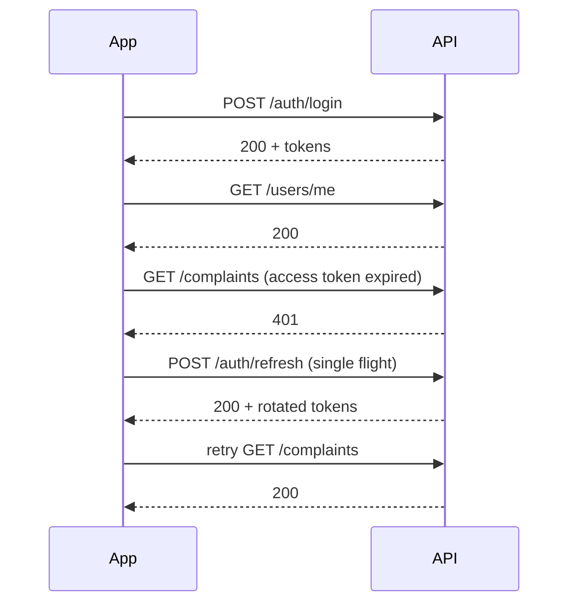
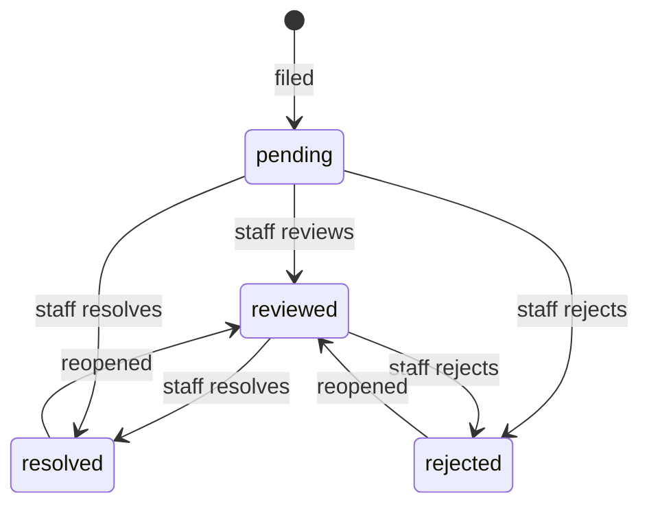

## Introduction

This handbook documents every public endpoint of the ProctorAI API in version 1.1.0. All endpoints are served by the API gateway and routed to the owning service. The API is JSON over HTTPS. Long-running and live data use Server-Sent Events (SSE).

A ready-to-run Postman collection with development and production environments is available in `backend/postman/`.

## Base URLs

| Environment | Base URL | Notes |
|---|---|---|
| Production (web origin) | `https://app.example.com/api` | Nginx strips `/api` and forwards to the gateway |
| Production before DNS | `http://<server-ip>/api` | Plain HTTP; bootstrap only |
| Development (gateway) | `http://localhost:7050` | Direct access to the gateway |
| Development (web origin) | `http://localhost:5173/api` | Vite proxy to the gateway |

In this handbook, paths are written relative to the base URL, for example `POST /auth/login`.

## Authentication

### Token model

| Token | Format | Default lifetime | Where it lives |
|---|---|---|---|
| Access token | JWT signed with HMAC (`JWT_SECRET`), claims: `sub` (email), user id, `iss`, `iat`, `exp` | 15 minutes (`JWT_ACCESS_EXPIRE_IN_SEC`) | Cookie `token` (path `/`) or `Authorization: Bearer` header |
| Refresh token | Opaque random value, stored server-side only as a hash | 30 days (`JWT_REFRESH_EXPIRE_IN_SEC`) | Cookie `refresh_token` (path `/auth`) or the request body |

Both cookies are `HttpOnly`, `SameSite=Lax`, and `Secure` when `APP_COOKIE_SECURE=true`.

Services accept the access token from the `token` cookie first, then from the `Authorization: Bearer <jwt>` header.

### Browser clients

Browsers rely on cookies. Send requests with credentials (`fetch(url, { credentials: "include" })`). The origin must be listed in `APP_ALLOWED_ORIGINS`.

### Native apps and server-to-server clients

Send `X-Token-Delivery: body` on `/auth/login` and `/auth/refresh`. The response then also contains `accessToken` and `refreshToken` in `tokenInfo`. Store the refresh token securely and send the access token as a bearer header.

### Sign in

`POST /auth/login` (public, rate-limited)

```json
{ "email": "admin@college.com", "password": "••••••••" }
```

Response `200 OK`:

```json
{
  "user": {
    "id": "6f1c…", "email": "admin@college.com", "name": "System Admin",
    "enabled": true, "verified": true, "customFields": {},
    "createdAt": "2026-11-01T09:00:00Z", "updatedAt": null
  },
  "tokenInfo": {
    "expiresIn": 900,
    "issuedAt": "2026-11-05T10:00:00Z",
    "expiresAt": "2026-11-05T10:15:00Z",
    "refreshExpiresIn": 2592000,
    "refreshExpiresAt": "2026-12-05T10:00:00Z",
    "accessToken": null,
    "refreshToken": null
  }
}
```

`accessToken` and `refreshToken` are only filled when `X-Token-Delivery: body` is sent. Two `Set-Cookie` headers are always returned.

| Status | Meaning |
|---|---|
| 400 | Validation failed (`email` must be a valid address ≤ 320 chars; `password` ≤ 200 chars) |
| 401 | Wrong credentials or disabled account |
| 429 | Gateway rate limit hit, or account temporarily locked after repeated failures |

### Refresh

`POST /auth/refresh` (public)

Body is optional: `{ "refreshToken": "…" }`. When omitted, the `refresh_token` cookie is used. The response has the same shape as sign-in and rotates the refresh token.

> [!IMPORTANT]
> Each refresh token can be used exactly once. Presenting a token that was already rotated is treated as theft: the whole token family is revoked and the client must sign in again. Clients must serialise refresh calls, for example with a single in-flight refresh promise.

### Sign out

| Endpoint | Auth | Effect |
|---|---|---|
| `POST /auth/logout` | Public | Revokes the given refresh token (body or cookie) and clears both cookies |
| `POST /auth/logout-all` | Required | Revokes every refresh token of the caller on every device |

Both return `200 {"message": "…"}`.

### Recommended client flow



## Conventions

### Content types and identifiers

- Requests and responses use `application/json; charset=utf-8`, except file imports (`multipart/form-data`) and streams (`text/event-stream`).
- All identifiers are UUIDs. Timestamps are ISO-8601 with offset (`OffsetDateTime`).
- Enumerations are lower case, for example `pending`, `multi_select`.

### HTTP methods

| Method | Use |
|---|---|
| `GET` | Read; never changes state |
| `POST` | Create, or trigger an action |
| `PUT` | Full replacement of a resource, or set a sub-resource (status, assignee, members, permissions) |
| `PATCH` | Partial update; omitted fields are unchanged |
| `DELETE` | Remove; returns `204 No Content` |

### Pagination and sorting

List endpoints that return `PageResponse` accept:

| Parameter | Default | Notes |
|---|---|---|
| `page` | `0` | Zero-based |
| `size` | `10` (20 for notifications and face audit, 50 for custom fields and the permission catalogue) | Clamped to 1–100 |
| `sortBy` | `createdAt` (varies) | Any sortable field of the resource |
| `direction` | `desc` | `asc` or `desc` |

```json
{
  "content": [ … ],
  "totalElements": 248,
  "totalPages": 25,
  "number": 0,
  "size": 10,
  "first": true,
  "last": false
}
```

### Filtering

Every other query parameter is a filter on a resource field. The syntax is `field=operator.value`. Without an operator, `eq` is used.

| Operator | Meaning | Example |
|---|---|---|
| `eq`, `neq` | Equal / not equal | `status=eq.pending` |
| `gt`, `gte`, `lt`, `lte` | Comparisons | `createdAt=gte.2026-10-01T00:00:00Z` |
| `like`, `ilike` | Pattern match (`*` or `%` wildcards), `ilike` is case-insensitive | `title=ilike.*hostel*` |
| `in` | Membership, up to 100 values | `priority=in.(high,urgent)` |
| `between` | Inclusive range | `createdAt=between.2026-10-01,2026-10-31` |
| `is` | Null checks | `assignedTo=is.null` |
| `or` | Disjunction of conditions | `or=(title.ilike.*fee*,description.ilike.*fee*)` |

Custom fields are filtered with the `cf.` prefix: `cf.hostel_block=eq.B`, `cf.year=gte.2`. Numeric comparisons on custom fields require a number. Unknown fields return `400 Unknown filter field`.

> [!NOTE]
> Results are always limited by row-level security. A filter can narrow what you see, never widen it.

### Errors

Every error uses one body shape:

```json
{
  "message": "'title' must not be blank",
  "statusCode": 400,
  "status": "BAD_REQUEST",
  "timestamp": "2026-11-05T10:02:11.481Z"
}
```

| Status | When |
|---|---|
| 400 Bad Request | Validation failed, malformed JSON, invalid filter, database check or business rule (`P0001`) failed |
| 401 Unauthorized | Missing, invalid or expired access token; missing refresh token |
| 403 Forbidden | RLS or a security rule denied the action |
| 404 Not Found | Resource does not exist or is not visible to the caller |
| 409 Conflict | Unique value already exists (for example email or department code) |
| 429 Too Many Requests | Login rate limit or account lockout |
| 500 Internal Server Error | Unexpected failure; details are only in server logs |

Business rules enforced in the database return readable messages, for example:

| Rule code (stripped from message) | Example message |
|---|---|
| `COMPLAINT_LOCKED` | complaint is already being processed |
| `INSUFFICIENT_LEVEL` | you cannot change workflow fields |
| `PERMISSION_ESCALATION` | you cannot grant a permission you do not hold |
| `SELF_ROLE_CHANGE` | you cannot change your own roles |
| `SELF_PROTECTED` | you cannot enable or disable your own account |
| `LAST_SYSTEM_ADMIN` | the last system admin cannot be removed |
| `SYSTEM_ROLE_PROTECTED` | system roles cannot be deleted |

### Streaming (SSE)

Streaming endpoints return `text/event-stream`. Each stream sends `event: ready` on connect, periodic `event: heartbeat` messages, then domain events. Use `EventSource` with credentials in browsers, or any SSE client with a bearer header in native apps. Reconnect with backoff when the stream closes; a stream also closes when the caller's session is revoked.

### Rate limits

| Scope | Default | Variables |
|---|---|---|
| `POST /auth/login` per client IP | Bucket of 30 tokens, refilled 1 token/s, 3 tokens per attempt: 10 immediate attempts, then 20 per minute | `LOGIN_RATE_LIMIT_BURST`, `_REPLENISH`, `_COST` |
| Failed sign-ins per account | 10 failures lock the account for 15 minutes | `LOGIN_MAX_FAILURES`, `LOGIN_LOCKOUT` |

### CORS

Allowed methods: `GET, POST, PUT, PATCH, DELETE, OPTIONS`. Allowed headers: `Content-Type, Authorization, Accept`. Credentials are allowed. Pre-flight results are cached for one hour.

## Authorization model

Each endpoint is protected by permissions of the form **entity × action × scope**. The database evaluates them per row.

| Action | Typical HTTP use |
|---|---|
| `read` | `GET` |
| `write` | `POST` (create) |
| `update` | `PUT`, `PATCH`, workflow changes |
| `delete` | `DELETE` |

| Scope | Rows covered |
|---|---|
| `own` | Rows that belong to the caller (own profile, own complaints, own notifications) |
| `department` | Rows linked to any department the caller is a member of |
| `all` | Every row |

Superuser roles (`system_admin`, `admin`) implicitly hold every `all` permission. The protected entities are:

`dashboard`, `users`, `user_roles`, `roles`, `role_permission`, `permissions`, `departments`, `department_users`, `complaints`, `complaint_comments`, `complaint_files`, `complaint_history`, `complaint_reporter`, `custom_fields`, `notifications`, `notification_devices`, `integrations`, `face_recognition`, `face_live_recognition`, `face_match_details`, `face_enrollments`, `face_enroll_lock`, `face_import`, `face_audit`, `same_role_peers`, `parallel_role_peers`, `senior_users`, `system_monitor`.

The caller's effective permissions are available at `GET /users/me/permissions`. Clients should use it to show or hide actions.

The **Permission** column in the endpoint tables names the primary entity and action checked. Row-level security may also consult related entities, for example `complaint_reporter` to reveal the reporter or `senior_users` to view more senior users.

## Users API

Service: `user-service` · Prefix: `/users`

| Method | Path | Description | Permission |
|---|---|---|---|
| GET | `/users` | List users (paged, filterable) | `users:read` |
| GET | `/users/me` | Current user profile | Authenticated |
| GET | `/users/me/events` | SSE stream of events for the current user (job progress, session changes) | Authenticated |
| GET | `/users/me/roles` | Current user's roles with permissions | Authenticated |
| GET | `/users/me/permissions` | Current user's effective permissions | Authenticated |
| GET | `/users/me/departments` | Current user's departments | Authenticated |
| POST | `/users` | Create a user → `201` | `users:write` |
| POST | `/users/bulk` | Create many users from a JSON array → `201` | `users:write` |
| GET | `/users/import/template?format=csv\|xlsx` | Download the import template | `users:write` |
| POST | `/users/import` | Import users from a CSV/Excel file (`multipart`, part `file`) → `202` | `users:write` |
| DELETE | `/users/bulk` | Delete many users (body: array of ids) → `204` | `users:delete` |
| GET | `/users/{id}` | Get one user | `users:read` |
| PUT | `/users/{id}` | Replace a user | `users:update` |
| PATCH | `/users/{id}` | Partially update a user | `users:update` |
| DELETE | `/users/{id}` | Delete a user → `204` | `users:delete` |
| GET | `/users/{id}/roles` | Roles of a user | `user_roles:read` |
| GET | `/users/{id}/permissions` | Effective permissions of a user | `role_permission:read` |
| GET | `/users/{id}/departments` | Departments of a user | `department_users:read` |

**Filterable fields:** `id`, `email`, `name`, `enabled`, `verified`, `createdAt`, `updatedAt`, `departmentId`, `roleId`, `cf.<key>`.

### Create user request

```json
{
  "name": "Aarav Mehta",
  "email": "aarav@college.com",
  "password": "Str0ngPass!",
  "roles": ["<role-uuid>"],
  "departments": ["<department-uuid>"],
  "customFields": { "roll_no": "CS-2026-041" },
  "enabled": true,
  "verified": true
}
```

| Field | Rules |
|---|---|
| `name` | Required, ≤ 200 |
| `email` | Required, valid, ≤ 320, unique |
| `password` | Required, 8–200 |
| `roles`, `departments` | Optional sets of UUIDs |
| `customFields` | Validated against applicable definitions |
| `enabled`, `verified` | Default `true` |

`PUT` requires `name` and `email`; `password` is optional. `PATCH` accepts any subset of `name`, `email`, `password`, `enabled`, `verified`, `roles`, `departments`, `customFields`.

### User response (`UserInfoDTO`)

```json
{
  "id": "…", "email": "aarav@college.com", "name": "Aarav Mehta",
  "enabled": true, "verified": true, "customFields": { "roll_no": "CS-2026-041" },
  "createdAt": "…", "updatedAt": "…",
  "roles": [ { "id": "…", "name": "student", "level": 50, "system": false, "superuser": false, "revealIdentity": false, "customFields": {}, "createdAt": "…" } ],
  "departments": [ { "id": "…", "name": "Computer Science", "code": "CS", "active": true, "customFields": {}, "createdAt": "…", "updatedAt": null } ]
}
```

### Bulk import

1. Download the template: `GET /users/import/template?format=csv`.
2. Fill columns `name, email, password, roles, departments, enabled, verified` (roles and departments by name or code; see `backend/seed-data/users-bulk-import.csv`).
3. Upload: `POST /users/import` with `file`. The response starts a background job; progress is pushed on `/users/me/events`.

## Departments API

Service: `department-service` · Prefix: `/departments`

| Method | Path | Description | Permission |
|---|---|---|---|
| GET | `/departments` | List departments (paged, filterable) | `departments:read` |
| POST | `/departments` | Create → `200` | `departments:write` |
| POST | `/departments/bulk` | Create many → `200` | `departments:write` |
| GET | `/departments/{id}` | Get one | `departments:read` |
| PUT | `/departments/{id}` | Replace | `departments:update` |
| PATCH | `/departments/{id}` | Partial update | `departments:update` |
| DELETE | `/departments/{id}` | Delete → `204` | `departments:delete` |
| GET | `/departments/{id}/members` | List members (`id`, `email`, `name`) | `department_users:read` |
| PUT | `/departments/{id}/members` | Add members `{ "userIds": [ … ] }` | `department_users:write` |
| DELETE | `/departments/{id}/members` | Remove members `{ "userIds": [ … ] }` | `department_users:delete` |

```json
{ "name": "Computer Science", "code": "CS", "description": "B.Tech and M.Tech CS", "active": true, "customFields": {} }
```

`name` ≤ 200 and `code` ≤ 50 are required on create and replace; `code` is unique. `description` ≤ 2000. `active` defaults to `true`.

## Roles and permissions API

Service: `role-service` · Prefix: `/roles`

| Method | Path | Description | Permission |
|---|---|---|---|
| GET | `/roles` | List roles (paged) | `roles:read` |
| POST | `/roles` | Create a role with permissions → `200` | `roles:write` |
| GET | `/roles/permissions` | Permission catalogue (paged, default size 50 sorted by `entity`, filterable by `entity`, `action`, `scope`) | `permissions:read` |
| GET | `/roles/{id}` | Role with its permissions | `roles:read` |
| PUT | `/roles/{id}` | Replace role attributes | `roles:update` |
| PATCH | `/roles/{id}` | Partial update | `roles:update` |
| DELETE | `/roles/{id}` | Delete → `204` (not for system roles) | `roles:delete` |
| GET | `/roles/{id}/permissions` | Permissions of a role | `role_permission:read` |
| PUT | `/roles/{id}/permissions` | Replace the permission set (body: array of permission ids) | `role_permission:update` |
| PATCH | `/roles/{id}/permissions` | Add permissions (body: array of ids) | `role_permission:write` |
| DELETE | `/roles/{id}/permissions` | Remove permissions (body: array of ids) | `role_permission:delete` |
| DELETE | `/roles/{id}/permissions/all` | Remove every permission → `204` | `role_permission:delete` |

```json
{
  "name": "warden",
  "description": "Hostel wardens",
  "level": 30,
  "permissions": ["<permission-uuid>", "…"],
  "revealIdentity": false,
  "customFields": {}
}
```

| Field | Rules |
|---|---|
| `name` | Required, ≤ 100, unique |
| `level` | 1–1000; lower is more senior; 0 is reserved for system administrators |
| `revealIdentity` | When `true`, holders see reporters of complaints even if hidden |
| `permissions` | You can only grant permissions you hold yourself |

## Complaints API

Service: `complaint-service` · Prefix: `/complaints`

| Method | Path | Description | Permission |
|---|---|---|---|
| GET | `/complaints` | List complaints (paged, filterable) | `complaints:read` |
| GET | `/complaints/stats` | Dashboard statistics | `dashboard:read` |
| POST | `/complaints` | File a complaint → `201` | `complaints:write` |
| GET | `/complaints/{id}` | Get one complaint | `complaints:read` |
| PATCH | `/complaints/{id}` | Partial update (content and, for staff, workflow fields) | `complaints:update` |
| PUT | `/complaints/{id}/status` | Change status | `complaints:update` (department/all) |
| PUT | `/complaints/{id}/assignee` | Assign | `complaints:update` (department/all) |
| DELETE | `/complaints/{id}` | Delete → `204` | `complaints:delete` |
| GET | `/complaints/{id}/history` | Status history | `complaint_history:read` |

**Filterable fields:** `id`, `title`, `description`, `category`, `priority`, `status`, `studentId`, `assignedTo`, `departmentId`, `createdAt`, `updatedAt`, `resolvedAt`, `cf.<key>`.

### Create complaint

```json
{
  "title": "Wi-Fi outage in Hostel B",
  "description": "No connectivity on floors 2–4 since Monday evening.",
  "category": "infrastructure",
  "priority": "high",
  "departmentId": "<uuid>",
  "studentId": "<uuid>",
  "subjectIds": ["<uuid>"],
  "customFields": { "hostel_block": "B" }
}
```

| Field | Rules |
|---|---|
| `title` | Required, ≤ 200 |
| `description` | Required, ≤ 5000 |
| `category` | ≤ 100, default `general` |
| `priority` | `low`, `medium` (default), `high`, `urgent` |
| `departmentId` | Optional; defaults from the reporter's department |
| `studentId` | Optional; defaults to the reporter |
| `subjectIds` | Up to 50 additional people the complaint concerns |

### Lifecycle



- `PUT /complaints/{id}/status` body: `{ "status": "resolved", "resolution": "Router replaced", "note": "Verified with students" }`. `resolution` ≤ 5000, `note` ≤ 1000.
- `PUT /complaints/{id}/assignee` body: `{ "assignedTo": "<user-uuid>" }`.
- `PATCH` accepts `title`, `description`, `category`, `priority`, `status`, `assignedTo`, `resolution`, `note`, `revealReporter`, `customFields`.
- Reporters without staff scope can edit only while the complaint is `pending`. Afterwards the API returns `403 complaint is already being processed`.
- Every status change writes a history entry with actor, from/to status and note.

### Complaint response (`ComplaintDTO`)

| Field | Description |
|---|---|
| `id`, `title`, `description`, `category`, `priority`, `status` | Core data |
| `studentId`, `studentName`, `subjects[]` | Who the complaint is about |
| `assignedTo`, `assignedToName` | Current handler |
| `departmentId`, `departmentName` | Owning department |
| `resolution`, `resolvedAt` | Outcome |
| `raisedBy`, `raisedByName`, `raisedByDepartments[]` | Reporter; `null` when hidden from the caller |
| `reporterVisible`, `revealReporter` | Whether the reporter is shown to the caller / to everyone |
| `customFields`, `createdAt`, `updatedAt` | Extension data and timestamps |

### Dashboard statistics

`GET /complaints/stats` returns counts within the caller's scope: `total`, per status, `unassigned`, per priority, `open`, `assignedToMe`, `mine`, `overdue`, `criticalOpen`, `createdLast7Days`, `resolvedLast7Days`, `avgResolutionHours`, `trend[] {day, created, resolved}` and `departments[] {name, total, open}`.

## Comments API

Prefix: `/complaints/{complaintId}/comments`

| Method | Path | Description | Permission |
|---|---|---|---|
| GET | `/` | List comments (internal ones only for staff) | `complaint_comments:read` |
| POST | `/` | Add `{ "body": "…", "internal": false }` → `201` | `complaint_comments:write` |
| DELETE | `/{commentId}` | Delete → `204` | `complaint_comments:delete` |

`body` is required, ≤ 4000 characters. Comments are immutable once posted.

## Files API

Service: `storage-service` · Prefix: `/complaints/{complaintId}/files`

| Method | Path | Description | Permission |
|---|---|---|---|
| GET | `/` | List files of a complaint | `complaint_files:read` |
| POST | `/upload-url` | Request a presigned upload URL → `201` | `complaint_files:write` |
| POST | `/{fileId}/confirm` | Confirm the upload finished → `200` with the file | `complaint_files:write` |
| GET | `/{fileId}/download-url` | Get a presigned download URL (`?inline=true` to view in browser) | `complaint_files:read` |
| DELETE | `/{fileId}` | Delete the file → `204` | `complaint_files:delete` |

### Upload sequence

1. `POST /upload-url` with `{ "fileName": "photo.jpg", "contentType": "image/jpeg", "sizeBytes": 482113 }` (`fileName` ≤ 200, `contentType` ≤ 150, `sizeBytes` > 0).
2. Response: `{ "fileId", "uploadUrl", "method": "PUT", "headers": { … }, "expiresAt" }`.
3. Send the bytes with `PUT uploadUrl` and exactly the returned headers. This request goes to the files domain, not the API.
4. `POST /{fileId}/confirm`. The file status changes from `pending` to `uploaded`.

Unconfirmed uploads are purged automatically. Download URLs expire; request a new one each time.

```json
{
  "id": "…", "complaintId": "…", "uploadedBy": "…", "uploadedByName": "Aarav Mehta",
  "fileName": "photo.jpg", "contentType": "image/jpeg", "sizeBytes": 482113,
  "kind": "attachment", "status": "uploaded", "createdAt": "…"
}
```

## Custom fields API

Service: `custom-field-service` · Prefix: `/custom-fields`

| Method | Path | Description | Permission |
|---|---|---|---|
| GET | `/custom-fields` | List definitions (paged, default size 50 sorted by `sortOrder` ascending, filterable) | `custom_fields:read` |
| GET | `/custom-fields/applicable?entity=users&roleId=…&departmentId=…` | Active definitions that apply in a context | Authenticated |
| GET | `/custom-fields/{id}` | Get one | `custom_fields:read` |
| POST | `/custom-fields` | Create → `201` | `custom_fields:write` |
| PUT | `/custom-fields/{id}` | Replace (entity, key and type are immutable) | `custom_fields:update` |
| PATCH | `/custom-fields/{id}` | Update `label`, `helpText`, `required`, `options`, `sortOrder`, `active` | `custom_fields:update` |
| DELETE | `/custom-fields/{id}` | Delete with its values → `204` | `custom_fields:delete` |

```json
{
  "entity": "complaints",
  "key": "hostel_block",
  "label": "Hostel block",
  "helpText": "Block where the issue happened",
  "dataType": "select",
  "required": false,
  "options": ["A", "B", "C"],
  "appliesToDepartmentId": null,
  "appliesToRoleId": null,
  "sortOrder": 10,
  "active": true
}
```

| Field | Rules |
|---|---|
| `entity` | `users`, `departments`, `roles`, `complaints` |
| `key` | `^[a-z][a-z0-9_]{0,49}$` |
| `dataType` | `text`, `number`, `bool`, `date`, `select`, `multi_select` |
| `options` | Up to 100 values (≤ 200 chars each), for `select` and `multi_select` |
| `minValue`, `maxValue`, `maxLength`, `pattern` | Optional validation (`pattern` ≤ 500 chars, regular expression) |

Values are sent inside the owning entity's `customFields` object.

## Notifications API

Service: `notification-service` · Prefix: `/notifications`

| Method | Path | Description | Permission |
|---|---|---|---|
| GET | `/notifications` | Inbox (paged, default size 20, filterable) | `notifications:read` |
| GET | `/notifications/unread-count` | `{ "unread": n }` | `notifications:read` |
| GET | `/notifications/stream` | SSE stream (`ready`, `heartbeat`, `notification`) | `notifications:read` |
| POST | `/notifications/read-all` | Mark all read → `{ "updated": n }` | `notifications:update` |
| PATCH | `/notifications/{id}/read` | Mark one read → `204` | `notifications:update` |
| DELETE | `/notifications/{id}` | Delete → `204` | `notifications:delete` |
| POST | `/notifications/send` | Send to users, roles and departments → `202` | `notifications:write` (department/all) |
| POST | `/notifications/devices` | Register a push device → `201` | `notification_devices:write` |
| GET | `/notifications/devices` | List own devices | `notification_devices:read` |
| DELETE | `/notifications/devices/{id}` | Remove a device → `204` | `notification_devices:delete` |
| GET | `/notifications/preferences` | Get preferences | Authenticated |
| PUT | `/notifications/preferences` | Update preferences | Authenticated |

### Send request

```json
{
  "userIds": ["…"],
  "roleIds": ["…"],
  "departmentIds": ["…"],
  "type": "announcement",
  "title": "Exam schedule published",
  "body": "Check the portal for your timetable.",
  "data": { "url": "/notifications" },
  "priority": "normal",
  "includeSender": false
}
```

At least one target is required. Limits: 1000 users, 100 roles, 100 departments; `type` ≤ 100, `title` ≤ 200, `body` ≤ 2000. Response: `{ "message": "…", "recipients": 128 }`.

### Notification object

```json
{
  "id": "…", "userId": "…", "type": "complaint.status", "title": "Complaint resolved",
  "body": "Wi-Fi outage in Hostel B was resolved", "data": { "complaintId": "…" },
  "priority": "normal", "source": "complaint-service",
  "readAt": null, "expiresAt": null, "createdAt": "…"
}
```

### Devices and preferences

- Register: `{ "platform": "android", "token": "<fcm token, 20–4096 chars>", "deviceName": "Pixel 8" }`. `platform` is `android`, `ios` or `web`.
- Preferences: `{ "pushEnabled": true, "realtimeEnabled": true, "mutedTypes": ["announcement"] }` (up to 100 muted types).

### Push integration (administrators)

Prefix: `/notifications/admin` · Permission: `integrations` (`read`/`update`/`delete`)

| Method | Path | Description |
|---|---|---|
| GET | `/integrations` | Integration status (`provider`, `enabled`, `configured`, `config`, `updatedAt`) |
| PUT | `/integrations/fcm` | `{ "enabled": true, "serviceAccountJson": "{…}" }`; the secret is encrypted at rest |
| DELETE | `/integrations/fcm` | Remove FCM credentials → `204` |
| POST | `/integrations/fcm/test` | Send a test push `{ "deviceToken"?, "title"?, "body"? }` → `{ credentialsValid, devicesTried, sent, failed, detail }` |
| GET | `/deliveries` | Delivery log (paged): `channel` (`realtime`/`fcm`), `status` (`sent`/`failed`/`skipped`), `detail` |
| GET | `/stats` | `{ realtimeSent, fcmSent, fcmFailed, skipped, activeDevices, notificationsLast24h }` |

## Face recognition API

Service: `face-service` · Prefix: `/faces`

| Method | Path | Description | Permission |
|---|---|---|---|
| POST | `/faces/enroll/{userId}` | Enroll or replace a user's face | `face_enrollments:write` / `update` (scoped to target) |
| POST | `/faces/recognize` | Recognise faces in an image | `face_recognition:read`; `face_live_recognition:read` when `source=camera` |
| GET | `/faces/enrollments` | List enrollments visible to the caller | `face_enrollments:read` |
| DELETE | `/faces/enrollments/{userId}` | Remove an enrollment → `204` | `face_enrollments:delete` |
| POST | `/faces/enrollments/{userId}/unlock` | Reset the self-enrollment lock → `204` | `face_enroll_lock:update` |
| GET | `/faces/audit?event=&subjectId=` | Face audit log (paged, default size 20; optional `event` and `subjectId` filters) | `face_audit:read` |
| GET | `/faces/enroll/bulk/template?format=csv\|xlsx` | Bulk enrollment template | `face_import:read` |
| POST | `/faces/enroll/bulk` | Bulk enroll from a file (`multipart`, part `file`) → `202` | `face_import:write` |

### Enroll

```json
{ "image": "<base64 JPEG or PNG, ≤ 8 MB decoded>" }
```

The largest face is used. Response:

```json
{
  "userId": "…", "name": "Aarav Mehta", "email": "aarav@college.com",
  "enrolledAt": "…", "selfEnrollCount": 1, "selfEnrollLocked": true,
  "canReplace": false, "canRemove": true, "canUnlock": false
}
```

A user enrolling themselves is limited to `FACE_SELF_ENROLL_LIMIT` attempts (default 1). Further self-enrollments return `403` until someone with department or all scope unlocks or re-enrolls them.

### Recognise

```json
{ "image": "<base64>", "source": "upload" }
```

`source` is `upload` (default) or `camera` (live recognition). Response:

```json
{
  "image": "<base64 PNG with boxes and names>",
  "width": 1280, "height": 720,
  "faces": [
    { "box": { "x": 410, "y": 122, "width": 160, "height": 182 },
      "confidence": 0.82, "matched": true,
      "user": { "id": "…", "name": "Aarav Mehta", "email": "aarav@college.com" } },
    { "box": { "x": 820, "y": 140, "width": 150, "height": 170 },
      "confidence": 0.0, "matched": false, "user": null }
  ]
}
```

`confidence` is the cosine similarity. It is only returned in detail to holders of `face_match_details`. A face whose best match the caller may not read is returned as not matched.

### Audit entry

`{ id, event, actorId, actorName, subjectId, subjectName, matched, confidence, facesDetected, detail, createdAt }` with `event` in `recognize`, `live_recognize`, `enroll`, `replace`, `remove`, `unlock`, `bulk_import`.

## System monitor API

Service: `monitor-service` · Prefix: `/system` · Permission: `system_monitor:read:all`

| Method | Path | Description |
|---|---|---|
| GET | `/system/overview` | `{ intervalSeconds, latest: SystemSnapshot, history: HistoryPoint[] }` |
| GET | `/system/stream` | SSE: `overview` first, then `snapshot` events, plus `heartbeat` |

A `SystemSnapshot` contains:

| Part | Content |
|---|---|
| `host` | Hostname, OS, CPU model and cores, per-core and total CPU, load average, memory and swap, disks, disk and network rates |
| `services[]` | Per instance: status, registration, uptime, CPU, heap, RSS, threads, request and error rate, latency, GC rate, DB pool usage |
| `database` | Version, size, connections by state, longest query, transaction and rollback rates, cache hit ratio, row rates, deadlocks, temp bytes, largest tables |
| `redis` | Version, role, clients, memory, ops/s, hit ratio, keys, evictions, throughput |
| `storage` | Files, bytes, pending files, evidence files |
| `issues[]` | Human-readable problems detected in the latest sample |

## Health and metrics

| Endpoint | Exposure | Purpose |
|---|---|---|
| `/actuator/health` on each service port | Docker network only | Liveness and readiness for Compose health checks |
| `/actuator/prometheus` on each service port | Docker network only | Prometheus metrics |
| `/healthz` on the frontend | Internal | Nginx health check |

`/api/actuator/*` is blocked at the web origin on purpose.

## Examples

### cURL: sign in and list pending complaints (native style)

```bash
BASE=https://app.example.com/api
TOKENS=$(curl -s -X POST "$BASE/auth/login" \
  -H 'Content-Type: application/json' -H 'X-Token-Delivery: body' \
  -d '{"email":"admin@college.com","password":"<password>"}')
ACCESS=$(echo "$TOKENS" | jq -r .tokenInfo.accessToken)

curl -s "$BASE/complaints?status=eq.pending&priority=in.(high,urgent)&size=20&sortBy=createdAt&direction=desc" \
  -H "Authorization: Bearer $ACCESS" | jq '.content[] | {title, priority, status}'
```

### TypeScript: browser client with single-flight refresh

```ts
let refreshing: Promise<void> | null = null;

async function api<T>(path: string, init: RequestInit = {}): Promise<T> {
  const send = () => fetch(`/api${path}`, {
    ...init,
    credentials: "include",
    headers: { "Content-Type": "application/json", ...init.headers },
  });
  let res = await send();
  if (res.status === 401) {
    refreshing ??= fetch("/api/auth/refresh", { method: "POST", credentials: "include" })
      .then((r) => { if (!r.ok) throw new Error("Session expired"); })
      .finally(() => { refreshing = null; });
    await refreshing;
    res = await send();
  }
  if (!res.ok) throw new Error((await res.json()).message);
  return res.status === 204 ? (undefined as T) : res.json();
}
```

### Upload a file

```bash
R=$(curl -s -X POST "$BASE/complaints/$CID/files/upload-url" -H "Authorization: Bearer $ACCESS" \
  -H 'Content-Type: application/json' \
  -d "{\"fileName\":\"photo.jpg\",\"contentType\":\"image/jpeg\",\"sizeBytes\":$(stat -c%s photo.jpg)}")
curl -s -X PUT "$(echo "$R" | jq -r .uploadUrl)" -H 'Content-Type: image/jpeg' --data-binary @photo.jpg
curl -s -X POST "$BASE/complaints/$CID/files/$(echo "$R" | jq -r .fileId)/confirm" -H "Authorization: Bearer $ACCESS"
```

### Subscribe to notifications

```ts
const es = new EventSource("/api/notifications/stream", { withCredentials: true });
es.addEventListener("notification", (e) => showToast(JSON.parse(e.data)));
es.onerror = () => { es.close(); setTimeout(connect, 3000); };
```

## Versioning and compatibility

- The API version follows the product version (`1.1.0`). Breaking changes are only introduced in a new major version and announced in the release notes.
- Clients must ignore unknown response fields; new optional fields can appear in minor releases.
- Deprecated endpoints are kept for at least one minor release and marked in the release notes.
