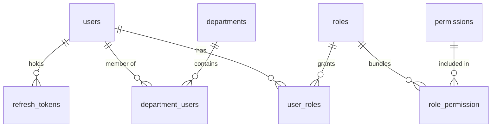
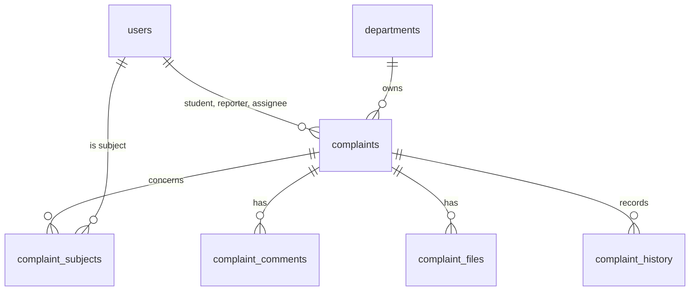
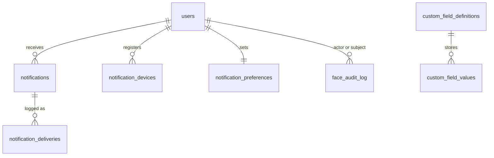
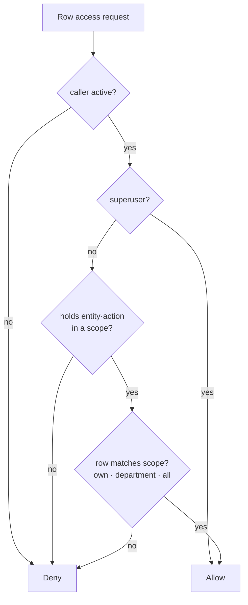
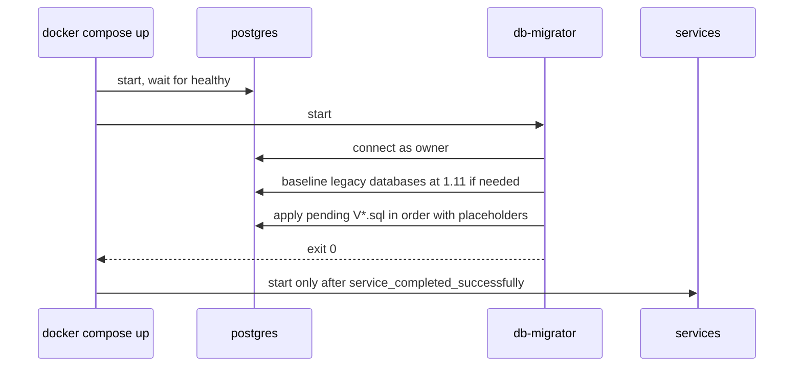

## Overview

ProctorAI stores all relational data, vector embeddings and authorization logic in a single PostgreSQL 16 database named by `POSTGRES_DB` (default `proctor`). The image is `pgvector/pgvector:pg16`, pinned by digest. The schema is managed by Flyway and applied by the `db-migrator` container before any service starts.

| Item | Value |
|---|---|
| Engine | PostgreSQL 16 with the `vector` extension |
| Extensions | `pgcrypto`, `vector`, `hstore`, `uuid-ossp` |
| Primary keys | `uuid` generated by `gen_random_uuid()` |
| Timestamps | `timestamptz`; `updated_at` maintained by triggers |
| Authorization | Row-Level Security on every business table |
| Migration tool | Flyway, location `backend/db-schema/src/main/resources/db/migration/` |
| Data volume | Docker volume `postgres_data` (production project `proctor-prod`) |

## Entity-relationship model

### Identity and access



### Complaints



### Notifications, custom fields and biometrics



## Tables

### Identity and access

| Table | Key columns | Notes |
|---|---|---|
| `users` | `id`, `email` (unique), `name`, `password` (bcrypt), `enabled`, `verified`, `created_at`, `updated_at` | Seeded administrator `admin@college.com` |
| `roles` | `id`, `name` (unique), `description`, `level` (≥ 0, default 100), `is_system`, `is_superuser`, `reveal_identity` | Lower level is more senior |
| `permissions` | `id`, `entity`, `action`, `scope`, `description` | Catalogue of entity × action × scope |
| `role_permission` | `role_id`, `permission_id` | Many-to-many |
| `user_roles` | `user_id`, `role_id` | Many-to-many; rows are immutable (remove and add) |
| `departments` | `id`, `name`, `code` (unique), `description`, `active` | |
| `department_users` | `user_id`, `department_id` | Membership drives department scope |
| `refresh_tokens` | `id`, `user_id`, `family_id`, `token_hash` (unique), `issued_at`, `expires_at`, `revoked_at`, `user_agent`, `ip_address` | Only hashes are stored |

### Complaints

| Table | Key columns | Notes |
|---|---|---|
| `complaints` | `id`, `title`, `description`, `category` (default `general`), `priority`, `status`, `student_id`, `raised_by`, `reveal_reporter`, `assigned_to`, `department_id`, `resolution`, `active`, `resolved_at` | Status and priority are enums |
| `complaint_subjects` | `complaint_id`, `user_id` | Additional people a complaint concerns |
| `complaint_comments` | `id`, `complaint_id`, `author_id`, `body`, `internal` | Immutable after insert |
| `complaint_files` | `id`, `complaint_id`, `uploaded_by`, `file_name`, `content_type`, `size_bytes`, `status` (`pending`/`uploaded`), `kind` (`attachment`/`evidence`), `file_url` | Storage fields immutable; cannot return to `pending` |
| `complaint_history` | `id`, `complaint_id`, `actor_id`, `from_status`, `to_status`, `note` | Written only by triggers |

### Extensions, notifications and biometrics

| Table | Key columns | Notes |
|---|---|---|
| `custom_field_definitions` | `entity`, `key`, `label`, `data_type`, `required`, `options`, `default_value`, `min_value`, `max_value`, `max_length`, `pattern`, `applies_to_role_id`, `applies_to_department_id`, `sort_order`, `active` | Entity, key and type are immutable |
| `custom_field_values` | `definition_id`, `entity`, `entity_id`, `value` (jsonb) | Purged when the owner is deleted |
| `notifications` | `user_id`, `type`, `title`, `body`, `data`, `priority` (`low`/`normal`/`high`), `source`, `read_at`, `expires_at` | |
| `notification_devices` | `user_id`, `platform` (`android`/`ios`/`web`), `token` (unique), `device_name`, `active`, `last_seen_at` | |
| `notification_preferences` | `user_id`, `push_enabled`, `realtime_enabled`, `muted_types` | One row per user |
| `integration_settings` | `provider` (`fcm`), `enabled`, `config`, `secret_ciphertext`, `updated_by` | Secret encrypted with AES-GCM |
| `notification_deliveries` | `notification_id`, `channel` (`realtime`/`fcm`), `status` (`sent`/`failed`/`skipped`), `detail`, `device_id` | |
| `face_audit_log` | `event`, `actor_id`, `subject_id`, `matched`, `confidence`, `faces_detected`, `detail` | Append-only audit |
| `face_embeddings` | Created by Spring AI on first boot of face-service | 512-dimension vectors; accessed only by face-service |

### Enumerations

| Type | Values |
|---|---|
| `permission_action` | `read`, `write`, `update`, `delete` |
| `permission_scope` | `own`, `department`, `all` |
| `complaint_status` | `pending`, `reviewed`, `resolved`, `rejected` |
| `complaint_priority` | `low`, `medium`, `high`, `urgent` |
| `custom_field_entity` | `users`, `departments`, `roles`, `complaints` |
| `custom_field_type` | `text`, `number`, `bool`, `date`, `select`, `multi_select` |
| `file_status` | `pending`, `uploaded` |
| `face_event` | `recognize`, `live_recognize`, `enroll`, `replace`, `remove`, `unlock`, `bulk_import` |
| `entity` | The 28 protected entities listed in the API Handbook |

## Database roles

| Role | Login | RLS | Used by | Privileges |
|---|---|---|---|---|
| Owner (`POSTGRES_USER`) | Yes | Bypasses (owner) | `db-migrator` only | Owns all objects; runs migrations |
| `authenticator` | Yes | Enforced | `auth-service` | Read `users`; full access to `refresh_tokens` |
| `proctor` | Yes | Enforced | All other services | DML on business tables under RLS; `CREATE` on schema for Spring AI's vector table |
| `auth_owner` | No | Bypasses | `security definer` functions | Owner of privileged functions; read all tables |

Services refuse to start when connected as a role that bypasses RLS (`DatabaseRoleGuard`). The owner password is never given to a service.

## Row-level security

### Session context

Each request runs in a transaction that first executes:

```sql
select set_config('auth.uid', :uid, true), set_config('auth.email', :email, true);
```

The third argument `true` makes the setting local to the transaction, so it cannot leak to another request on a pooled connection. Helper `uid()` reads it.

### Policy pattern

For most tables the policies are generated with one template per action:

```sql
create policy <table>_select on <table> for select to proctor
  using (can_access('<entity>'::entity, 'read', to_jsonb(<table>)));
create policy <table>_insert on <table> for insert to proctor
  with check (can_access('<entity>'::entity, 'write', to_jsonb(<table>)));
create policy <table>_update on <table> for update to proctor
  using (can_access('<entity>'::entity, 'update', to_jsonb(<table>)))
  with check (can_access('<entity>'::entity, 'update', to_jsonb(<table>)));
create policy <table>_delete on <table> for delete to proctor
  using (can_access('<entity>'::entity, 'delete', to_jsonb(<table>)));
```

Complaints, comments, files, history, subjects, custom fields, refresh tokens, notification preferences, deliveries and the face audit log have hand-written policies with extra rules (for example, internal comments are hidden from reporters and subjects).

### Security functions

| Function | Purpose |
|---|---|
| `uid()` | Current user id from `auth.uid` |
| `is_active_user(id)`, `is_superuser(id)` | Account and role state |
| `user_min_level(id)`, `caller_min_level()` | Seniority (lowest level held) |
| `holds_permission(entity, action, scopes[])` | Whether the caller holds a permission in any of the scopes |
| `shares_department(id)`, `in_department(dept)` | Department relationships |
| `user_relation(target)` | `self`, `junior`, `same_role`, `parallel_role` or `senior` |
| `row_scope_match(entity, row, scope)` | Whether a row is inside `own`, `department` or `all` for the caller |
| `can_access(entity, action, row)` | Main decision used by policies |
| `has_scope(entity, action, scopes[], row)` | Whether access is granted through specific scopes (used to separate staff from self-service) |
| `can_view_user`, `can_manage_user`, `can_manage_role` | User and role management decisions |
| `complaint_staff(...)`, `is_complaint_subject(...)` | Complaint visibility helpers |

### Decision flow



## Triggers and invariants

| Trigger function | Guarantees |
|---|---|
| `set_updated_at` | Maintains `updated_at` |
| `guard_roles` | System roles cannot be deleted or renamed; flags immutable; level 0 and superuser roles only by system admins |
| `guard_user_roles` | No self role changes; only system admins assign superuser roles; the last system admin keeps the role |
| `guard_role_permission` | No permission escalation; superuser permissions are implicit |
| `guard_users` | Email, enabled and verified changes need sufficient level; no self enable/disable; the last system admin cannot be deleted or disabled |
| `guard_department_users` | Department membership changes respect management rights |
| `complaints_before_insert` | Sets `raised_by`, defaults `student_id` and `department_id`, forces `pending` for self-service, sets `resolved_at` |
| `complaints_before_update` | `raised_by` immutable; reporter visibility protected; self-service edits only while `pending` |
| `complaints_record_history` | Writes `complaint_history` on create and every status change, with the note from `app.status_note` |
| `complaint_children_before_insert`, `complaint_children_immutable` | Comments and files belong to one complaint permanently |
| `guard_files_update` | Storage fields immutable; uploaded files cannot return to `pending` |
| `guard_custom_field_definitions` | Entity, key and type cannot change |
| `purge_custom_values` | Deletes custom values when the owner row is deleted |
| `revoke_refresh_tokens` | Revokes sessions when a user is disabled or the password changes |

Rule violations raise SQLSTATE `42501` with a code prefix (for example `COMPLAINT_LOCKED:`). The API maps them to `403` and strips the prefix from the message.

## Domain functions

| Migration | Functions |
|---|---|
| `V1_7__storage_functions.sql` | `purge_stale_uploads(interval)`, `complaint_file_usage(...)` |
| `V1_8__notification_functions.sql` | `system_create_notification`, `system_delivery_profile`, `system_active_devices`, `system_deactivate_device`, `system_log_delivery`, `system_integration`, `register_device`, `purge_old_notifications`, `complaint_parties`, `resolve_notification_recipients` |
| `V1_9__monitor_functions.sql` | Database statistics used by the system monitor |

`system_*` functions are `security definer` and run as `auth_owner` for trusted internal work (for example creating notifications for other users) without widening the `proctor` role.

## Migrations

### Inventory

| Version | File | Contents |
|---|---|---|
| 1.1 | `V1_1__roles.sql` | Database roles and their passwords |
| 1.2 | `V1_2__extensions.sql` | `pgcrypto`, `vector`, `hstore`, `uuid-ossp` |
| 1.3 | `V1_3__schema.sql` | Types, tables, indexes, RLS enabled |
| 1.4 | `V1_4__security_functions.sql` | `can_access`, `has_scope` and helpers |
| 1.5 | `V1_5__rls_policies.sql` | Row-level security policies |
| 1.6 | `V1_6__triggers.sql` | Guards, history and housekeeping triggers |
| 1.7 | `V1_7__storage_functions.sql` | Upload purge and usage |
| 1.8 | `V1_8__notification_functions.sql` | Notification delivery and recipients |
| 1.9 | `V1_9__monitor_functions.sql` | Monitoring statistics |
| 1.10 | `V1_10__seed.sql` | Permissions, default roles and grants, administrator |
| 1.11 | `V1_11__grants.sql` | Privileges per role |

### How migrations run



Placeholders `authenticator_password`, `app_password` and `admin_password` are filled from `AUTHENTICATOR_USER_PASSWORD`, `APP_USER_PASSWORD` and `ADMIN_PASSWORD`. Databases created by the older `init/` scripts are detected and baselined at 1.11 without changes.

### Writing a new migration

1. Create the next version file, for example `V2__add_complaint_tags.sql`. Use `V2_1__…`, `V2_2__…` for a series.
2. Make it forward-only and idempotent where practical (`if not exists`, `on conflict do nothing`).
3. Enable RLS and add policies for every new table. Grant only the privileges the service needs in the same migration.
4. Add or update tests in `backend/db-migrator/src/test` (`MigrationTest`, `RowLevelSecurityTest`).
5. Run `cd backend && ./gradlew build`, then `./setup.sh` to apply locally.

> [!CAUTION]
> Never edit or rename a released migration. Flyway validates checksums and refuses to start when a released file changes, which stops every service.

### Migration review checklist

| Check | Why |
|---|---|
| New tables have `enable row level security` and policies | Otherwise rows are invisible (or exposed, if policies are too wide) |
| Grants added for `proctor` / `authenticator` | Services fail with permission errors otherwise |
| Long operations avoid full table locks | Prevent downtime during upgrade |
| Destructive changes split across releases (expand, migrate, contract) | Allows rollback of application images |
| Backup taken before production upgrade | Migrations are not reversible automatically |

## Operational queries

```sql
select version, description, installed_on, success
from flyway_schema_history order by installed_rank desc limit 5;

select relname, n_live_tup, pg_size_pretty(pg_total_relation_size(relid))
from pg_stat_user_tables order by pg_total_relation_size(relid) desc limit 10;

select count(*) filter (where revoked_at is null and expires_at > now()) as active_sessions
from refresh_tokens;
```

Run them with `docker compose … exec postgres psql -U "$POSTGRES_USER" -d "$POSTGRES_DB"`.
