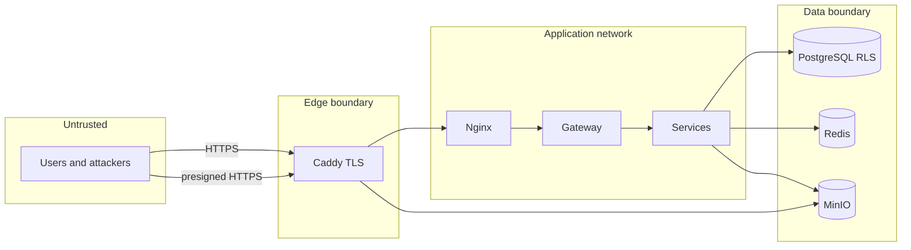

## Security objectives

| Objective | Statement |
|---|---|
| Confidentiality | Users only see the rows, files and identities their permissions allow, including reporter identities and biometric matches. |
| Integrity | Workflow rules (complaint locking, history, role levels, last administrator) cannot be bypassed by any client or service bug. |
| Availability | Brute force and resource exhaustion are limited; services restart automatically. |
| Accountability | Status changes and every face recognition operation are audited with actor and time. |
| Privacy | Biometric data stays on the institution's server and is never sent to external AI services. |

## Threat model

The model uses STRIDE over the main trust boundaries: Internet → edge, edge → application, application → data.

| Threat (STRIDE) | Example | Controls |
|---|---|---|
| Spoofing | Password guessing, stolen refresh token | bcrypt (cost 12 for the seeded admin), per-IP rate limit, per-account lockout, refresh rotation with reuse detection, `HttpOnly` cookies |
| Tampering | Changing a complaint after processing, escalating a role | Database triggers (`COMPLAINT_LOCKED`, `PERMISSION_ESCALATION`, `SYSTEM_ROLE_PROTECTED`), RLS `with check` clauses |
| Repudiation | Denying a status change or a face lookup | Immutable `complaint_history`, `face_audit_log`, trace IDs in logs |
| Information disclosure | Reading other departments' complaints, identifying a face outside scope, CORS abuse from the files domain | RLS on every table, out-of-scope matches returned as unknown, reporter masking, strict CORS that refuses storage and registry origins |
| Denial of service | Login floods, huge uploads | Gateway token bucket, body size limits (300 MB web, 250 MB files), 8 MB face image limit, memory limits per container |
| Elevation of privilege | Service compromise reading all data, container breakout | Least-privilege DB roles without `BYPASSRLS`, role guard at startup, read-only containers, all capabilities dropped, `no-new-privileges`, non-root users |

## Identity and session security

| Control | Implementation |
|---|---|
| Password storage | bcrypt via `BcryptPasswordHasher`; minimum length 8 on create |
| Access token | JWT, HMAC-SHA with `JWT_SECRET` (startup fails if shorter than 32 bytes), 15-minute default lifetime, issuer checked |
| Refresh token | Random opaque value; only a hash is stored; rotated on every refresh; reuse revokes the family |
| Cookies | `HttpOnly`, `Secure` (production), `SameSite=Lax`; refresh cookie scoped to `/auth` |
| Revocation | Changing the password or disabling a user revokes all refresh tokens (trigger) |
| Rate limiting | Redis token bucket on `/auth/login` keyed by real client IP |
| Lockout | 10 failed attempts lock the account for 15 minutes (configurable) |
| Client IP | Resolved from `X-Forwarded-For` honouring only `APP_TRUSTED_PROXIES` hops, so clients cannot spoof their address |
| Default credentials | Production setups replace `admin123` with a random password shown once |

## Authorization controls

Authorization is enforced in three layers:

1. **Service layer:** the JWT filter authenticates every request except the public auth paths.
2. **Database policies:** every query runs under RLS bound to `auth.uid` and calls `can_access(entity, action, row)`.
3. **Database triggers:** invariants that cannot be expressed as row filters, such as seniority and workflow locks.

Additional protections:

- Users can only manage themselves and more junior users. Managing peers requires explicit `same_role_peers` or `parallel_role_peers` permissions. Viewing more senior users requires `senior_users`.
- Nobody can grant a permission they do not hold.
- Superuser roles can only be created or assigned by a system administrator; the last system administrator cannot be removed, disabled or deleted.
- Reporter identity is masked unless the viewer's role has `revealIdentity`, the viewer holds `complaint_reporter:read`, or the complaint sets `revealReporter`.
- Internal comments are visible only to staff.

## Network and transport security

| Layer | Control |
|---|---|
| Edge | Caddy with automatic TLS (Let's Encrypt, ZeroSSL fallback), HTTP→HTTPS redirect, HSTS `max-age=31536000`, HTTP/3, `admin off` |
| Headers | `X-Content-Type-Options: nosniff`, `Referrer-Policy: strict-origin-when-cross-origin`, `Server` and `Via` removed; Nginx adds `X-Frame-Options: SAMEORIGIN` on the app |
| Exposure | Only the edge publishes ports 80/443. Registry (8761) and MinIO console (9201) bind to `127.0.0.1` only. Port 9200 is published only until DNS is ready |
| Registry | HTTP Basic auth on every Eureka call, password ≥ 32 characters, constant-time comparison; public domain serves only the dashboard paths |
| Metrics | `/actuator/*` reachable only inside the Docker network; `/api/actuator/` returns 404 |
| CORS | Origins managed by setup; wildcards and non-HTTP schemes rejected; storage and registry origins refused |
| Files | Presigned URLs with expiry; MinIO CORS restricted to the app origin; app user limited to one bucket by policy |

> [!WARNING]
> The IP bootstrap stage uses plain HTTP. Do not enter real passwords or personal data until DNS is configured and setup has switched to HTTPS.

## Container and host hardening

| Control | Production setting |
|---|---|
| Read-only root filesystem | `read_only: true`, with a 256 MB `tmpfs` for `/tmp` |
| Linux capabilities | `cap_drop: ALL` (edge adds only `NET_BIND_SERVICE`) |
| Privilege escalation | `security_opt: no-new-privileges:true` |
| User | Non-root `app` user; face-service on distroless without a shell |
| Resources | Memory limits per container; JVM exits on OOM |
| Images | Third-party images pinned by SHA-256 digest; JRE trimmed with `jlink` |
| Logs | JSON, rotated 10 MB × 5 |

Host recommendations:

- Ubuntu 22.04/24.04 LTS with unattended security upgrades enabled.
- `ufw` allowing only SSH, 80/tcp, 443/tcp, 443/udp (and 9200/tcp only before DNS).
- SSH with keys only, root login disabled, `fail2ban` or equivalent.
- Docker daemon kept current; only administrators in the `docker` group (membership is root-equivalent).

## Secret management

| Secret | Purpose | Minimum strength | Rotation impact |
|---|---|---|---|
| `POSTGRES_PASSWORD` | Database owner | 32+ random chars | Change in DB and env together |
| `AUTHENTICATOR_USER_PASSWORD`, `APP_USER_PASSWORD` | Service DB roles | 32+ random chars | Rerun migrator (sets passwords), restart services |
| `JWT_SECRET` | Signs access tokens | ≥ 32 bytes | All access tokens become invalid; users refresh automatically |
| `REDIS_PASSWORD` | Redis auth | 32+ random chars | Restart Redis and all services |
| `MINIO_ROOT_PASSWORD`, `S3_SECRET_KEY` | Object storage | 32+ random chars | Update MinIO user and storage-service |
| `DISCOVERY_PASSWORD` | Registry auth | ≥ 32 chars (enforced) | Restart every service |
| `NOTIFICATION_SECRET_KEY` | Encrypts FCM credentials (AES-256-GCM, key derived with SHA-256) | 32+ random chars | Re-enter FCM credentials after rotation |
| `ADMIN_PASSWORD` | Seeded admin on a new database | 20 random chars, shown once | Change in the app afterwards |

Rules:

1. Setup generates every secret with a cryptographically secure generator and writes the env file with `600` permissions.
2. Never commit `.env`, `.env.production` or `docker/.env`. They are already in `.gitignore`.
3. Keep an encrypted offline copy of the env file (password manager or vault). Without it, existing volumes cannot be reused.
4. Rotate secrets after staff changes or any suspected exposure, during a maintenance window.

## Data protection and privacy

ProctorAI processes personal data, including biometric data, which is special-category data under laws such as the GDPR and India's DPDP Act 2023.

| Topic | Guidance |
|---|---|
| Lawful basis | Obtain explicit, informed consent before face enrollment; document the purpose |
| Minimisation | Store only embeddings and audit records; do not keep raw enrollment images longer than needed |
| Access | Grant `face_recognition`, `face_live_recognition` and `face_match_details` only to roles that need them |
| Transparency | Users can view their own face audit records (`face_audit:read:own`) |
| Erasure | Delete a user's enrollment with `DELETE /faces/enrollments/{userId}`; deleting a user cascades their data |
| Retention | Define retention for notifications, audit logs and resolved complaints; purge functions exist for notifications and stale uploads |
| Breach response | Follow the incident runbook (PAI-OPS-009) and notify authorities within the legal deadline |
| Model licence | InsightFace buffalo_l models are licensed for non-commercial research use; review before commercial deployment |

## Production hardening checklist

| # | Check | Status |
|---|---|---|
| 1 | Domains configured; HTTPS active on app, files and registry | ☐ |
| 2 | Port 9200 closed in firewall after DNS is ready | ☐ |
| 3 | Administrator password changed after first sign-in; one-time password removed from notes | ☐ |
| 4 | `APP_COOKIE_SECURE=true` and only HTTPS origins in `APP_ALLOWED_ORIGINS` | ☐ |
| 5 | `APP_EXTRA_ORIGINS` reviewed; no unnecessary origins | ☐ |
| 6 | Env file permissions `600`; encrypted offline copy stored | ☐ |
| 7 | SSH keys only; root login disabled; unattended upgrades on | ☐ |
| 8 | Default roles reviewed; face permissions limited to required staff | ☐ |
| 9 | Backups scheduled and a restore tested (PAI-BDR-008) | ☐ |
| 10 | Monitoring and alerting active (PAI-OPS-009) | ☐ |
| 11 | CAA DNS record restricting certificate authorities (optional) | ☐ |
| 12 | `FACE_MATCH_THRESHOLD` validated on local data to balance false matches and misses | ☐ |
| 13 | Docker images updated to the latest ProctorAI patch release | ☐ |

## Security testing

| Activity | Frequency | Tooling |
|---|---|---|
| Automated tests (RLS, auth flow, rate limit, JWT) | Every build | `./gradlew build` with Testcontainers |
| Dependency scanning | Every build | OWASP Dependency-Check or `gradle dependencyCheckAnalyze`, `npm audit` |
| Container image scanning | Every release | Trivy or Grype |
| TLS configuration check | After deployment | SSL Labs, `testssl.sh` |
| Penetration test | Yearly or after major changes | OWASP ASVS Level 2 as baseline |

## Vulnerability reporting

Report suspected vulnerabilities privately to the maintainers (Varshit Tyagi & Mohini Teotia) through the GitHub repository's private security advisory feature. Do not open public issues for security problems. Include affected version, reproduction steps and impact. Maintainers acknowledge within 5 working days and coordinate disclosure after a fix is released.
