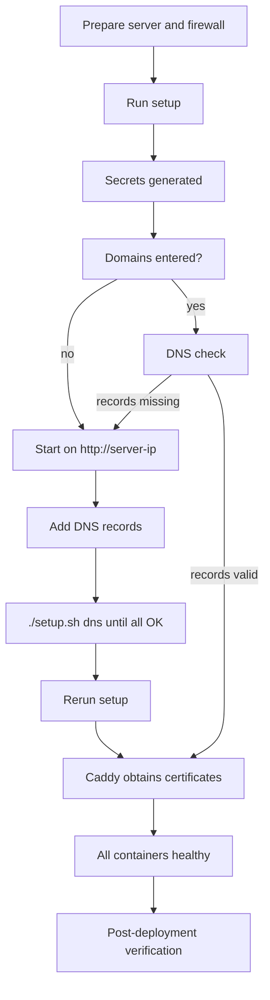

## Purpose and scope

This runbook takes an operator from an empty Linux server to a verified, HTTPS-secured ProctorAI installation. It covers both supported methods:

| Method | Command | Use when |
|---|---|---|
| **A. Published images** (recommended) | `cd docker && ./setup.sh` | Running a released version; fastest (about 5 minutes) |
| **B. Build from source** | `./setup.sh prod` | Running your own code changes (about 20 minutes) |

Both methods configure the same hardened stack: Caddy edge with automatic TLS, read-only containers, health-checked startup and automatic database migrations.

> [!IMPORTANT]
> Use one method per server. Both share the Docker volumes of project `proctor-prod` but keep separate secrets files (`docker/.env` and `backend/.env.production`). Switching methods requires copying the secrets first, otherwise the services cannot open the existing database.

## Roles and responsibilities

| Role | Responsibility |
|---|---|
| Deployment owner | Executes this runbook, records results in the sign-off table |
| DNS administrator | Creates A (and optional CAA) records |
| Security reviewer | Confirms the hardening checklist in PAI-SEC-005 |
| Application administrator | First sign-in, password change, initial roles and departments |

## Planning

### Server sizing

| Profile | Users | vCPU | RAM | Disk (SSD) |
|---|---|---|---|---|
| Evaluation | ≤ 50 | 2 | 8 GB | 40 GB |
| Small institution | ≤ 1,000 | 4 | 16 GB | 100 GB |
| Medium institution | ≤ 5,000 | 8 | 32 GB | 250 GB + object storage growth |

Face recognition is CPU-bound; more cores improve recognition latency. Plan object storage for complaint attachments (up to 250 MB per file).

### Prerequisites

| Item | Requirement |
|---|---|
| OS | Ubuntu 22.04 or 24.04 LTS (any 64-bit x86_64 Linux works) |
| Software | Docker 25+ and Docker Compose 2.21+ |
| Network | Public IPv4 address; inbound TCP 80, TCP 443, UDP 443; outbound HTTPS |
| DNS | Three names, for example `app.example.com`, `files.example.com`, `registry.example.com` |
| Email | Contact address for certificate expiry notices |
| Access | SSH user with `sudo` |

### Information to collect

| Value | Example | Recorded |
|---|---|---|
| Server public IP | `203.0.113.10` | |
| Web app domain | `app.example.com` | |
| File storage domain | `files.example.com` | |
| Service registry domain | `registry.example.com` | |
| Certificate email | `ops@example.com` | |
| Target version | `1.1.0` | |

## Pre-deployment checklist

| # | Check | Done |
|---|---|---|
| 1 | Server provisioned with the sizing above and SSH access confirmed | ☐ |
| 2 | OS fully updated (`sudo apt update && sudo apt upgrade -y`) | ☐ |
| 3 | Cloud firewall / security group allows TCP 80, TCP 443, UDP 443, SSH (and TCP 9200 temporarily) | ☐ |
| 4 | DNS A records created, or a plan to start on the IP address first | ☐ |
| 5 | No AAAA records unless the server really serves IPv6 | ☐ |
| 6 | Secure place ready to store the env file and the one-time admin password | ☐ |
| 7 | Maintenance window agreed (for upgrades of existing installations) | ☐ |

## Server preparation

```bash
sudo apt update && sudo apt install -y git curl
curl -fsSL https://get.docker.com | sudo sh
sudo usermod -aG docker "$USER"
newgrp docker
docker run --rm hello-world

sudo ufw allow OpenSSH
sudo ufw allow 80/tcp
sudo ufw allow 443/tcp
sudo ufw allow 443/udp
sudo ufw allow 9200/tcp
sudo ufw enable
```

Port 9200 serves uploaded files only until DNS is in place. It is closed again in the post-deployment steps.

Recommended extras: enable `unattended-upgrades`, disable SSH password authentication and root login, and set the server time zone and NTP.

## DNS records

| Type | Name | Value |
|---|---|---|
| A | `app.example.com` | Server public IPv4 |
| A | `files.example.com` | Server public IPv4 |
| A | `registry.example.com` | Server public IPv4 |
| CAA (optional) | `example.com` | `0 issue "letsencrypt.org"` |
| CAA (optional) | `example.com` | `0 issue "sectigo.com"` (allows the ZeroSSL fallback) |

Setup prints these records with the real IP and the status of each one. DNS can be added before or after installation.

## Method A: deploy published images

```bash
git clone --depth 1 https://github.com/vishaltyagi807/Proctor-AI.git
cd Proctor-AI/docker
./setup.sh
```

Only the `docker/` folder is needed; it can also be copied with `scp -r docker <user>@<server>:~/proctorai`. If the Docker Hub repository is private, run `docker login` first.

Setup will:

1. Create `.env` with new random secrets (mode `600`).
2. Ask for the three domains and the certificate email (leave domains empty to start on the IP address).
3. Detect the public IP, check DNS and generate the Caddy configuration.
4. Pull the images for the selected version and start every container, waiting until all are healthy.
5. Replace the default administrator password with a random one and **display it once**.
6. Print the URLs and any DNS records still missing.

For an unattended install:

```bash
APP_DOMAIN=app.example.com FILES_DOMAIN=files.example.com \
REGISTRY_DOMAIN=registry.example.com ACME_EMAIL=ops@example.com \
./setup.sh --yes
```

Add `PUBLIC_IP=<address>` if the server cannot detect its own address. Select a version with `./setup.sh update 1.1.0`.

## Method B: deploy from source

```bash
git clone https://github.com/vishaltyagi807/Proctor-AI.git
cd Proctor-AI
./setup.sh prod
```

The prompts and automatic steps match Method A. In addition, setup downloads the face models (about 190 MB, checksum-verified) and builds every image. Settings are stored in `backend/.env.production`.

## Deployment flow



### Switching from IP to HTTPS

| Part | Before DNS | After DNS |
|---|---|---|
| Web app | `http://<server-ip>` | `https://app.example.com` |
| File storage | `http://<server-ip>:9200` | `https://files.example.com` |
| Service registry | SSH tunnel to `http://localhost:8761` | `https://registry.example.com` |
| MinIO console | SSH tunnel to `http://localhost:9201` | SSH tunnel only |

```bash
./setup.sh dns            # every record must show OK
./setup.sh                # Method A, rerun to switch to HTTPS
./setup.sh prod --yes     # Method B
```

## Post-deployment verification

| # | Check | Command / action | Expected |
|---|---|---|---|
| 1 | All containers healthy | `./setup.sh status` (Method B: `--prod`) | Every service `healthy`; `db-migrator` and `minio-init` exited `0` |
| 2 | Migrations applied | `./setup.sh logs db-migrator` | `Successfully applied` or `Schema is up to date` |
| 3 | HTTPS valid | `curl -I https://app.example.com` | `HTTP/2 200`, `strict-transport-security` header present |
| 4 | HTTP redirects | `curl -I http://app.example.com` | `308` to HTTPS |
| 5 | API reachable | `curl -s https://app.example.com/api/auth/refresh -X POST` | `401` JSON error body |
| 6 | Actuator hidden | `curl -I https://app.example.com/api/actuator/health` | `404` |
| 7 | Sign-in | Browser: sign in as `admin@college.com` with the one-time password | Dashboard loads |
| 8 | Password change | Users → your account → Edit → New password | Success; old password rejected at next sign-in |
| 9 | File upload | Create a test complaint and attach a file | Upload completes; download works |
| 10 | Real-time | Change the complaint status in a second browser | Notification appears without reload |
| 11 | Face service | Faces → enroll a test user, then recognise | Match shown; audit entry recorded |
| 12 | System monitor | Admin → System | All services listed as UP |
| 13 | Registry protected | Open `https://registry.example.com` | Basic auth prompt |
| 14 | Close temporary port | `sudo ufw delete allow 9200/tcp` (and in the cloud firewall) | Port closed |

## Initial application setup

1. Sign in as the administrator and change the password (Users → your account → Edit → New password).
2. Create departments (Departments → New, or bulk create).
3. Review default roles (`teacher`, `student`) and create additional roles as needed (Roles & access).
4. Define custom fields required by the institution (Custom fields).
5. Import users from CSV/Excel using the template (Users → Import).
6. Optionally configure FCM push (Admin → Notifications → Integrations).
7. Assign face recognition permissions only to roles that need them.
8. Create a second superuser account for break-glass access and store its credentials securely.

## Handover

Deliver to the institution:

| Item | Location |
|---|---|
| URLs (app, files, registry) | Deployment record |
| Env file backup (encrypted) | Password manager / vault |
| Administrator credentials | Handed over in person or via password manager |
| Backup schedule and restore test result | PAI-BDR-008 |
| Monitoring contacts and alert routes | PAI-OPS-009 |

## Rollback of a failed first installation

A first installation has no data to protect. To start again:

```bash
./setup.sh purge          # Method A (asks to confirm); Method B: ./setup.sh purge --prod
```

> [!WARNING]
> Purge deletes the database, uploads, face enrollments and TLS certificates. Let's Encrypt limits repeated issuance for the same names, so avoid purging production more than necessary. For rollback of upgrades, follow PAI-REL-010.

## Everyday commands

| Task | Method A (`docker/`) | Method B (repository root) |
|---|---|---|
| Status | `./setup.sh status` | `./setup.sh status --prod` |
| Logs | `./setup.sh logs [service]` | `./setup.sh logs --prod [service]` |
| TLS and access logs | `./setup.sh logs edge` | `./setup.sh logs --prod edge` |
| Stop / remove (keep data) | `./setup.sh stop` / `down` | `./setup.sh stop --prod` / `down --prod` |
| Update | `./setup.sh update [version]` | Pull code, then `./setup.sh prod --yes` |
| DNS status | `./setup.sh dns` | `./setup.sh dns` |
| Registry and MinIO console | `ssh -L 8761:127.0.0.1:8761 -L 9201:127.0.0.1:9201 <user>@<server>` | Same |

## Troubleshooting during deployment

| Symptom | Likely cause | Resolution |
|---|---|---|
| Certificates never become active | Ports 80/443 blocked or DNS not pointing to the server | Open ports; `./setup.sh dns`; `./setup.sh logs edge` |
| Validation fails only sometimes | AAAA record to an address the server does not serve | Remove the AAAA record |
| A service stays `unhealthy` | Missing variable, DB not ready, memory limit | `./setup.sh logs <service>`; check free RAM |
| `db-migrator` exits non-zero | Edited released migration or database error | Read its logs; never edit released migrations |
| Browser CORS error | Origin not allowed | Add to `APP_EXTRA_ORIGINS`, rerun setup |
| Uploads fail after HTTPS switch | Old files URL cached in a native app | Rebuild the app with the HTTPS `VITE_SERVER_URL` |
| Image pull denied | Private repository | `docker login` |

## Sign-off

| Step | Name | Date | Signature |
|---|---|---|---|
| Deployment completed | | | |
| Verification completed | | | |
| Security checklist completed | | | |
| Handover accepted | | | |
