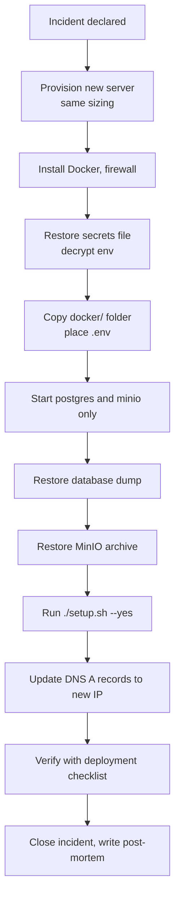

## Objectives

| Metric | Target | Meaning |
|---|---|---|
| RPO (Recovery Point Objective) | 24 hours (standard) · 1 hour (with WAL archiving) | Maximum data loss acceptable |
| RTO (Recovery Time Objective) | 4 hours | Maximum time to restore service on a new server |
| Backup retention | 7 daily, 4 weekly, 12 monthly | Rolling retention |
| Restore test | Monthly | A backup is only valid once restored successfully |

## What must be protected

| Asset | Location | Contains | Criticality |
|---|---|---|---|
| PostgreSQL | Volume `proctor-prod_postgres_data` | Users, roles, complaints, history, notifications, face embeddings, audit logs, Flyway history | Critical |
| MinIO | Volume `proctor-prod_minio_data` | Complaint attachments and evidence | Critical |
| Secrets file | `docker/.env` or `backend/.env.production` | All passwords and keys, domains, version | Critical |
| Redis | Volume `proctor-prod_redis_data` | Rate-limit buckets, transient streams, progress | Low (rebuilt automatically) |
| Caddy data | Volumes `caddy_data`, `caddy_config` | TLS certificates and ACME account | Medium (re-issued automatically, but rate-limited) |
| Temporary files | Volumes `user_storage`, `face_storage` | In-flight import files | Low |
| Edge configuration | `edge/Caddyfile` next to the setup script | Generated proxy configuration | Low (regenerated by setup) |

> [!CAUTION]
> The secrets file is as important as the database. The database roles' passwords, the JWT key and the key that encrypts FCM credentials are stored only there. Without it, a restored database cannot be opened by the services until all passwords are reset.

## Backup procedure

### Variables

Published-image deployments (run inside `docker/`):

```bash
PROD="docker compose -f docker-compose.yaml --env-file .env"
```

Source deployments (run in the repository root):

```bash
PROD="docker compose -f backend/docker-compose.prod.yaml --env-file backend/.env.production"
```

### Database (logical, consistent, online)

```bash
mkdir -p /var/backups/proctorai && cd /var/backups/proctorai
$PROD exec -T postgres sh -c 'pg_dump -U "$POSTGRES_USER" -Fc "$POSTGRES_DB"' > proctor-$(date +%F).dump
$PROD exec -T postgres sh -c 'pg_dumpall -U "$POSTGRES_USER" --roles-only' > roles-$(date +%F).sql
```

`pg_dump -Fc` produces a compressed, consistent snapshot while the system is running. The roles file documents database roles; passwords are re-applied from the env file during restore.

### Object storage

```bash
docker run --rm -v proctor-prod_minio_data:/data:ro -v "$PWD":/backup alpine \
  tar czf /backup/minio-$(date +%F).tgz -C /data .
```

For large stores, prefer incremental mirroring with the MinIO client to an off-site S3 bucket:

```bash
docker run --rm --network proctor-prod_default --env-file <env-file> minio/mc sh -c \
  'mc alias set src http://minio:9000 "$MINIO_ROOT_USER" "$MINIO_ROOT_PASSWORD" && \
   mc alias set dst https://s3.backup-provider.example "$BACKUP_KEY" "$BACKUP_SECRET" && \
   mc mirror --overwrite src/$S3_BUCKET dst/proctorai-files'
```

### Secrets file

```bash
gpg --symmetric --cipher-algo AES256 -o env-$(date +%F).gpg docker/.env
```

Store the encrypted file and its passphrase in separate places (for example the passphrase in the organisation's password manager).

### Certificates (optional)

```bash
docker run --rm -v proctor-prod_caddy_data:/data:ro -v "$PWD":/backup alpine \
  tar czf /backup/caddy-$(date +%F).tgz -C /data .
```

## Automation

Create `/usr/local/sbin/proctorai-backup.sh` (owned by root, mode `700`):

```bash
#!/usr/bin/env bash
set -euo pipefail
cd /opt/proctorai/docker
PROD="docker compose -f docker-compose.yaml --env-file .env"
DEST=/var/backups/proctorai
STAMP=$(date +%F-%H%M)
mkdir -p "$DEST"
$PROD exec -T postgres sh -c 'pg_dump -U "$POSTGRES_USER" -Fc "$POSTGRES_DB"' > "$DEST/proctor-$STAMP.dump"
docker run --rm -v proctor-prod_minio_data:/data:ro -v "$DEST":/backup alpine \
  tar czf "/backup/minio-$STAMP.tgz" -C /data .
find "$DEST" -type f -mtime +7 -name '*.dump' -delete
find "$DEST" -type f -mtime +7 -name '*.tgz' -delete
rclone copy "$DEST" offsite:proctorai-backups --max-age 25h
```

Schedule it daily at 02:30:

```bash
echo '30 2 * * * root /usr/local/sbin/proctorai-backup.sh >> /var/log/proctorai-backup.log 2>&1' \
  | sudo tee /etc/cron.d/proctorai-backup
```

Follow the 3-2-1 rule: three copies, on two kinds of media, one off-site. Encrypt off-site copies (for example with `rclone crypt`).

## Restore procedures

### Restore the database into a running stack

Use this to recover from data corruption or accidental deletion on the same server.

```bash
$PROD stop api-gateway auth-service user-service department-service role-service \
  complaint-service storage-service custom-field-service notification-service face-service monitor-service
$PROD exec -T postgres sh -c 'pg_restore -U "$POSTGRES_USER" -d "$POSTGRES_DB" --clean --if-exists' \
  < proctor-YYYY-MM-DD.dump
$PROD up -d
```

Stopping the services first prevents writes during the restore. `db-migrator` runs again on `up` and applies any newer migrations.

### Restore object storage

```bash
$PROD stop storage-service minio
docker run --rm -v proctor-prod_minio_data:/data -v "$PWD":/backup alpine \
  sh -c 'rm -rf /data/* /data/.minio.sys && tar xzf /backup/minio-YYYY-MM-DD.tgz -C /data'
$PROD up -d
```

### Restore a single complaint's files

Mount the archive in a temporary container, locate the object under `proctor-files/` by the key stored in `complaint_files.file_url`, and copy it back with `mc cp`.

## Disaster recovery: full server loss



### Step by step

1. **Provision** a server with the same or larger sizing (PAI-DEP-006, Planning).
2. **Prepare** Docker and the firewall (PAI-DEP-006, Server preparation).
3. **Restore secrets:** `gpg -d env-YYYY-MM-DD.gpg > docker/.env && chmod 600 docker/.env`.
4. **Start data services and create the database roles:**
   ```bash
   cd docker
   $PROD up -d postgres minio
   $PROD run --rm db-migrator
   ```
   The migrator creates the `authenticator`, `proctor` and `auth_owner` roles with the passwords from the env file, so the restored grants resolve.
5. **Restore the database** over the freshly migrated schema:
   ```bash
   $PROD exec -T postgres sh -c 'pg_restore -U "$POSTGRES_USER" -d "$POSTGRES_DB" --clean --if-exists' < proctor-YYYY-MM-DD.dump
   ```
6. **Restore files** with the MinIO procedure above.
7. **Start everything:** `./setup.sh --yes`. The migrator re-applies role passwords from the env file and any pending migrations.
8. **Repoint DNS** A records to the new IP if it changed. Certificates are issued again automatically (or restore `caddy_data` to avoid re-issuance).
9. **Verify** with the post-deployment checklist in PAI-DEP-006.
10. **Communicate** recovery and the data-loss window (time of the last backup) to stakeholders.

### Recovery time budget

| Step | Estimated time |
|---|---|
| Provision and prepare server | 30 min |
| Restore secrets and start data services | 10 min |
| Database restore (10 GB) | 20–40 min |
| File restore (100 GB) | 60–120 min |
| Start stack, DNS, verification | 30 min |
| **Total** | **≈ 2.5–4 hours** |

## Point-in-time recovery (optional)

To reach an RPO of minutes, enable continuous WAL archiving with a tool such as pgBackRest or WAL-G against an off-site S3 bucket. This requires a custom PostgreSQL configuration (`archive_mode=on`, `archive_command`) mounted into the `postgres` service and a base backup schedule. Document the procedure separately when adopted and test PITR quarterly.

## Restore testing

| Test | Frequency | Pass criteria |
|---|---|---|
| Database dump restores into a scratch container | Monthly | `pg_restore` exits 0; row counts match production within the backup window |
| Full DR drill on a staging server | Twice a year | Service usable within RTO; sign-in, complaint view and file download succeed |
| Secrets file decrypt test | Quarterly | File decrypts with the stored passphrase |

Scratch restore check:

```bash
docker run -d --name pg-restore-test -e POSTGRES_PASSWORD=test pgvector/pgvector:pg16
sleep 10
docker exec -i pg-restore-test sh -c 'createdb -U postgres proctor && pg_restore -U postgres -d proctor --no-owner' < proctor-YYYY-MM-DD.dump
docker exec pg-restore-test psql -U postgres -d proctor -c 'select count(*) from complaints;'
docker rm -f pg-restore-test
```

Role-related warnings during a scratch restore with `--no-owner` are expected.

## Backup log

| Date | Type | Size | Location | Verified by | Restore tested |
|---|---|---|---|---|---|
| | | | | | |
| | | | | | |
