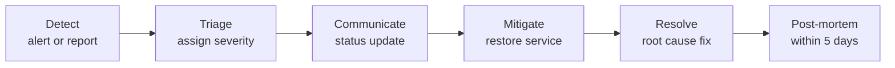

## Observability overview

| Signal | Source | Access |
|---|---|---|
| Container health | Docker health checks on `/actuator/health` | `./setup.sh status` |
| Live system view | `monitor-service` (Admin → System) | Web app, requires `system_monitor:read:all` |
| Metrics | `/actuator/prometheus` on every backend service | Inside the Docker network |
| Logs | JSON logs per container, 10 MB × 5 rotation | `./setup.sh logs [service]` |
| Request tracing | Trace ID on every log line, propagated by the gateway | Search logs by trace ID |
| Edge access logs | Caddy JSON access log | `./setup.sh logs edge` |
| Service registry | Eureka dashboard | `https://registry.<domain>` (Basic auth) or SSH tunnel |

## Built-in system monitor

The System page shows, refreshed every few seconds over SSE:

| Panel | Key indicators |
|---|---|
| Host | CPU total and per core, load average, memory and swap, disk usage per mount, disk and network throughput |
| Services | Each instance: UP/DOWN, registered, uptime, CPU, heap, RSS, threads, requests/s, errors/s, latency, GC rate, DB pool usage |
| Database | Connections (active, idle, idle in transaction, waiting), longest query, transactions/s, rollback rate, cache hit ratio, deadlocks, temp bytes, largest tables |
| Redis | Clients, memory vs max, ops/s, hit ratio, keys, evictions |
| Storage | Files, bytes, pending uploads, evidence files |
| Issues | Automatically detected problems in the latest sample |

Services report samples to Redis every 2 seconds with a 10-second TTL. A service that stops reporting disappears from the panel within 10 seconds.

## Prometheus and Grafana (recommended)

Run Prometheus on the stack's network to collect metrics without exposing them publicly.

```yaml
scrape_configs:
  - job_name: proctorai
    metrics_path: /actuator/prometheus
    static_configs:
      - targets:
          - api-gateway:7050
          - auth-service:7051
          - user-service:7052
          - department-service:7053
          - role-service:7054
          - complaint-service:7055
          - storage-service:7056
          - custom-field-service:7057
          - notification-service:7058
          - face-service:7059
          - monitor-service:7060
```

```bash
docker run -d --name prometheus --network proctor-prod_default \
  -v /opt/monitoring/prometheus.yml:/etc/prometheus/prometheus.yml:ro \
  -p 127.0.0.1:9090:9090 prom/prometheus
```

Add node-exporter and cAdvisor for host and container metrics, and Grafana for dashboards (JVM Micrometer and Spring Boot dashboards work out of the box).

## Service level indicators and alert rules

| SLI / condition | Threshold | Severity | Action |
|---|---|---|---|
| Any container unhealthy | > 2 minutes | Critical | INC-01 |
| Edge returns 5xx | > 2 % of requests for 5 min | Critical | INC-02 |
| Gateway p95 latency | > 1 s for 10 min | Warning | INC-03 |
| Login 429 rate | > 50/min | Warning | INC-07 (possible attack) |
| JVM heap used | > 90 % of max for 10 min | Warning | INC-04 |
| Container restarts | > 3 in 15 min | Critical | INC-04 |
| PostgreSQL connections | > 80 % of `max_connections` | Warning | INC-05 |
| Disk usage (any mount) | > 80 % warning, > 90 % critical | Warning/Critical | INC-06 |
| Certificate expiry | < 14 days | Warning | INC-08 |
| Backup job | Not successful in 26 h | Critical | PAI-BDR-008 |
| FCM failures | > 10 % of push deliveries for 1 h | Warning | INC-09 |

Example Prometheus rules:

```yaml
groups:
  - name: proctorai
    rules:
      - alert: ServiceDown
        expr: up{job="proctorai"} == 0
        for: 2m
        labels: { severity: critical }
      - alert: HighErrorRate
        expr: sum(rate(http_server_requests_seconds_count{status=~"5.."}[5m])) by (instance)
              / sum(rate(http_server_requests_seconds_count[5m])) by (instance) > 0.02
        for: 5m
        labels: { severity: critical }
      - alert: HeapPressure
        expr: sum(jvm_memory_used_bytes{area="heap"}) by (instance)
              / sum(jvm_memory_max_bytes{area="heap"}) by (instance) > 0.9
        for: 10m
        labels: { severity: warning }
```

External uptime checks (for example every minute against `https://app.<domain>/` and `https://app.<domain>/api/auth/refresh` expecting `401`) catch DNS, TLS and edge failures that internal metrics miss.

## Logs

```bash
./setup.sh logs                       # all services
./setup.sh logs complaint-service     # one service
docker logs --since 30m proctor-prod-auth-service-1 2>&1 | jq -r 'select(.level=="ERROR")'
```

To follow a request across services, take the trace ID from the first log line of the failing call and search every service:

```bash
for c in $(docker ps --format '{{.Names}}' | grep proctor-prod); do
  docker logs --since 1h "$c" 2>&1 | grep -F "<trace-id>" | sed "s/^/[$c] /"
done
```

For long-term retention ship logs to Loki, Elasticsearch or a cloud log service with a Docker logging driver or Promtail.

## Severity levels

| Severity | Definition | Response target | Examples |
|---|---|---|---|
| SEV-1 | Platform unavailable or data at risk | 15 min, continuous until resolved | Database down, TLS failure, data corruption, breach |
| SEV-2 | Major feature unavailable | 1 hour | Complaints cannot be filed, uploads fail, sign-in fails for many |
| SEV-3 | Degraded or partial | Next business day | Face recognition slow, push notifications failing |
| SEV-4 | Cosmetic or single user | Planned | UI glitch, one user's import row error |

## Incident process



1. **Acknowledge** the alert and open an incident record (time, reporter, symptom).
2. **Triage:** check `./setup.sh status`, the System page and recent changes (deploys, config edits).
3. **Communicate** to stakeholders for SEV-1/2 every 30 minutes.
4. **Mitigate** first (restart, roll back, scale), investigate second.
5. **Preserve evidence** before destructive actions: `docker logs` output, database state.
6. **Resolve** and verify with the post-deployment checklist (PAI-DEP-006).
7. **Post-mortem:** blameless write-up with timeline, impact, root cause, action items.

## Playbooks

### INC-01: a service is unhealthy

```bash
./setup.sh status
./setup.sh logs <service>
docker inspect --format '{{json .State.Health}}' proctor-prod-<service>-1 | jq
```

| Finding | Fix |
|---|---|
| Cannot connect to PostgreSQL / Redis | Check those containers first (INC-05); services recover automatically |
| `Required variable … is missing` | Fix the env file; rerun setup |
| `DatabaseRoleGuard` violation | Service connected with a privileged role; check `APP_USER_NAME` / `AUTHENTICATOR_USER_NAME` |
| Not registered in Eureka | Check `discovery-server` health and `DISCOVERY_PASSWORD` consistency |
| `OutOfMemoryError` / repeated restarts | INC-04 |

Restart a single service: `$PROD restart <service>` (see PAI-BDR-008 for `$PROD`).

### INC-02: users see errors (5xx) or the site is down

1. `curl -I https://app.<domain>`. No response means edge or DNS: check `./setup.sh logs edge` and `./setup.sh dns`.
2. `502`/`504` from the edge means frontend or gateway: check `frontend` and `api-gateway` health.
3. API errors with `500`: find the trace ID in gateway logs and follow it into the service.
4. If a deployment happened in the last hour, roll back (PAI-REL-010).

### INC-03: slow responses

| Check | Command / place |
|---|---|
| Host CPU or memory saturated | System page → Host; `top`, `free -m` |
| Long-running queries | System page → Database → longest query; `select pid, now()-query_start, query from pg_stat_activity where state <> 'idle' order by 2 desc;` |
| DB pool exhausted | System page → Services → DB pool pending |
| Face recognition load | CPU on `face-service`; limit concurrent live recognition |

Cancel a runaway query: `select pg_cancel_backend(<pid>);`

### INC-04: memory pressure or restart loop

1. `docker stats --no-stream` to see usage against limits.
2. Raise the limit for the affected service in the compose file (`deploy.resources.limits.memory`) and rerun setup, or add RAM to the host.
3. For `face-service`, very large images or many concurrent recognitions increase memory; keep `FACE_MAX_IMAGE_BYTES` at 8 MB.

### INC-05: database problems

```bash
$PROD exec postgres pg_isready
$PROD exec postgres psql -U "$POSTGRES_USER" -d "$POSTGRES_DB" -c "select count(*), state from pg_stat_activity group by state;"
```

| Symptom | Fix |
|---|---|
| Too many connections | Find idle-in-transaction sessions and terminate; check for a stuck service |
| Disk full | INC-06; PostgreSQL stops accepting writes when the disk is full |
| Corruption or accidental deletion | Stop services and restore (PAI-BDR-008) |
| Failed migration after upgrade | Read `db-migrator` logs; roll back the image version (PAI-REL-010) |

### INC-06: disk space

```bash
df -h
docker system df
sudo du -sh /var/lib/docker/volumes/* | sort -h | tail
```

Free space safely: `docker image prune -a` (removes unused images), clean old backups, archive old resolved complaints' files. Never delete files inside volumes by hand.

### INC-07: brute-force or suspicious sign-ins

1. Inspect the edge access log for many `POST /api/auth/login` from one IP: `./setup.sh logs edge | grep auth/login`.
2. The gateway rate limit and account lockout already slow attacks. For sustained attacks, block the source at the firewall (`sudo ufw deny from <ip>`).
3. If an account may be compromised: disable it (this revokes its sessions), reset the password, and review its recent actions in complaint history and the face audit log.

### INC-08: TLS certificate problems

1. `./setup.sh logs edge | grep -i -E "acme|certificate|error"`.
2. Confirm ports 80 and 443 are open and DNS A records point to the server (`./setup.sh dns`).
3. Remove wrong AAAA records.
4. If Let's Encrypt rate limits are hit, Caddy falls back to ZeroSSL; wait or restore `caddy_data` from backup.

### INC-09: notifications not delivered

| Channel | Checks |
|---|---|
| In-app (real time) | User preference `realtimeEnabled`; Redis healthy; browser shows SSE stream open; corporate proxies buffering SSE |
| Push (FCM) | Admin → Notifications → Integrations → Test; check delivery log `detail`; device registered and active; user preference `pushEnabled`; muted types |

### INC-10: suspected security breach

1. Declare SEV-1. Limit access: block suspicious IPs, disable affected accounts.
2. Preserve evidence: export container logs, take a database dump, snapshot the disk.
3. Rotate secrets (PAI-SEC-005, Secret management). Rotating `JWT_SECRET` and revoking refresh tokens signs out every user:
   ```sql
   update refresh_tokens set revoked_at = now() where revoked_at is null;
   ```
4. Assess data exposure using the audit tables; notify data-protection authorities and affected users as required by law.
5. Patch the root cause, then restore normal operation and complete a post-mortem.

## Routine operations calendar

| Frequency | Task |
|---|---|
| Daily | Check alerts and backup log; glance at System page issues |
| Weekly | Review disk growth, error rates, failed sign-ins; `docker image prune` |
| Monthly | Restore test (PAI-BDR-008); review roles with face and admin permissions; apply OS updates |
| Quarterly | Update to the latest ProctorAI patch release; rotate operator credentials; review alert thresholds |
| Yearly | DR drill; penetration test; review this runbook |

## Post-mortem template

| Section | Content |
|---|---|
| Summary | What happened, impact in one paragraph |
| Timeline | Detection, key actions, resolution (UTC) |
| Impact | Users affected, duration, data loss |
| Root cause | Technical and process causes |
| What went well / badly | Honest assessment |
| Action items | Owner and due date for each fix |
