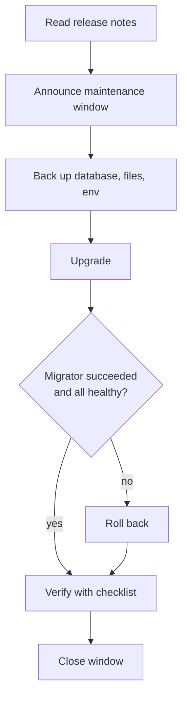

## Versioning policy

ProctorAI follows Semantic Versioning `MAJOR.MINOR.PATCH`.

| Part | Increment when | Examples |
|---|---|---|
| MAJOR | Breaking API change, removal of a feature, migration that cannot coexist with the previous version | Endpoint removed, response field renamed |
| MINOR | New backward-compatible feature, new endpoint, additive migration | New custom field type, new report |
| PATCH | Bug or security fix without new features | Fix in a trigger, dependency update |

One version number covers the whole platform: all backend images, the frontend image and the native apps share it. The current release is **1.1.0**.

### Where the version lives

| Location | Purpose |
|---|---|
| Git tag `vX.Y.Z` | Source of truth for a release |
| Image tags `vishaltyagi807/proctor-ai:<service>-X.Y.Z` | Published images, one per service |
| Image tags `…:<service>-latest` | Moving tag for the newest release |
| `PROCTOR_VERSION` default in `docker/docker-compose.yaml` | Version pulled by fresh installs |
| `frontend/package.json` → `version` | App version shown in the UI and native packages |
| `frontend/src-tauri/tauri.conf.json` → `version` | Points to `../package.json`, so native apps inherit the frontend version |

> [!NOTE]
> At the time of writing `frontend/package.json` reports `1.0.0` while the published images are `1.1.0`. Align both in the next release so the UI, native apps and server report the same version.

## Branching model

| Branch | Purpose |
|---|---|
| `main` | Always releasable; every release is tagged here |
| `v2` / `development-*` | Integration branches for the next minor or major version |
| `feature/<name>` | Short-lived feature work, merged by pull request |
| `hotfix/<version>` | Branched from a release tag for urgent patches |

All changes enter `main` through reviewed pull requests with a green build.

## Release checklist

### Prepare

| # | Step | Done |
|---|---|---|
| 1 | All planned pull requests merged; `main` builds green | ☐ |
| 2 | `cd backend && ./gradlew build` passes locally (needs Docker) | ☐ |
| 3 | `cd frontend && npm ci && npm run lint && npm run build` passes | ☐ |
| 4 | New migrations reviewed against the checklist in PAI-DB-004 | ☐ |
| 5 | Upgrade tested on a copy of production data (restore latest backup to staging) | ☐ |
| 6 | Version bumped in `frontend/package.json` (native apps follow it); `PROCTOR_VERSION` default updated in `docker/docker-compose.yaml` | ☐ |
| 7 | `CHANGELOG.md` updated (format below) | ☐ |

### Build and publish images

```bash
REPO=vishaltyagi807/proctor-ai
VERSION=1.2.0
for service in db-migrator discovery-server api-gateway auth-service user-service department-service role-service \
               complaint-service storage-service custom-field-service notification-service monitor-service; do
  docker build --target service --build-arg SERVICE=$service --build-arg GRADLE_FLAGS=--no-build-cache \
    -t $REPO:$service-$VERSION -t $REPO:$service-latest backend
done
docker build --target face-service --build-arg SERVICE=face-service --build-arg GRADLE_FLAGS=--no-build-cache \
  -t $REPO:face-service-$VERSION -t $REPO:face-service-latest backend
docker build --target prod -t $REPO:frontend-$VERSION -t $REPO:frontend-latest frontend
docker push --all-tags $REPO
```

The CI/CD design (PAI-CICD-011) automates these steps on a tag push.

### Tag and announce

1. Tag: `git tag -a v1.2.0 -m "ProctorAI 1.2.0"` and push the tag.
2. Create a GitHub release with the changelog section and upgrade notes.
3. Attach native app installers (desktop, APK/AAB, IPA via store) built with `VITE_SERVER_URL` where appropriate.

## Changelog format

`CHANGELOG.md` follows the *Keep a Changelog* convention:

```markdown
## [1.2.0] - 2026-12-01
### Added
- Complaint tags with filtering (`tags=in.(…)`).
### Changed
- Default face match threshold documented per deployment.
### Fixed
- Notification stream reconnect after token refresh.
### Security
- Updated Spring Boot to 3.5.x for CVE-YYYY-NNNN.
### Upgrade notes
- Migration V2__complaint_tags.sql adds a table; no downtime expected.
```

## Upgrade procedure (production)



1. Read the release notes, especially **Upgrade notes** and **Security**.
2. Take a fresh backup (PAI-BDR-008): database dump, MinIO archive, env file.
3. Upgrade:
   - Published images: `cd docker && ./setup.sh update 1.2.0`
   - From source: update the code (`git fetch --tags && git checkout v1.2.0`), then `./setup.sh prod --yes`
4. Watch `./setup.sh logs db-migrator` until it exits successfully, then `./setup.sh status`.
5. Run the post-deployment verification in PAI-DEP-006 (at least items 1–10).
6. Record the upgrade (version, time, operator, result).

Expected downtime is the time to restart the containers plus migrations, typically 1–3 minutes.

## Rollback

### Decision guide

| Situation | Rollback type |
|---|---|
| New version misbehaves, no migration in the release | **Image rollback** |
| Release contained only additive migrations (new tables/columns) | **Image rollback** (old code ignores new structures) |
| Release contained destructive or incompatible migrations, or data was corrupted | **Full rollback** (images + database restore) |
| Migration failed during upgrade | **Image rollback**; failed migration is rolled back by PostgreSQL's transactional DDL in most cases. Check `flyway_schema_history` |

### Image rollback

```bash
cd docker
./setup.sh update 1.1.0
```

From source: `git checkout v1.1.0 && ./setup.sh prod --yes`.

> [!WARNING]
> Flyway's default settings ignore *future* migrations, so an older `db-migrator` starts normally against a database that a newer release has already migrated. That does not make the old services compatible with the new schema. If the newer release changed or removed structures the old code uses, perform a full rollback.

### Full rollback

1. Stop the application services (keep `postgres` and `minio` running).
2. Restore the pre-upgrade database dump and, if needed, the MinIO archive (PAI-BDR-008, Restore procedures).
3. Switch to the previous version (`./setup.sh update <previous>`).
4. Verify and communicate the data-loss window (changes made after the backup are lost).

### Expand-migrate-contract

To keep image rollbacks possible, ship schema changes in stages:

| Release | Database | Application |
|---|---|---|
| N | Add new column/table (expand) | Writes both old and new |
| N+1 | Backfill data | Reads new, still writes both |
| N+2 | Remove old column (contract) | Uses only new |

## Hotfix process

1. Branch from the release tag: `git checkout -b hotfix/1.1.1 v1.1.0`.
2. Apply the minimal fix with a test; open a pull request.
3. After merge, tag `v1.1.1`, build and publish images, update the changelog.
4. Merge the fix forward into active development branches.
5. Notify operators with the CVE or issue reference and urgency.

## Native app releases

| Platform | Artifact | Distribution |
|---|---|---|
| Windows | `.msi`, `.exe` (NSIS) | Direct download; sign with a code-signing certificate |
| macOS | `.dmg`, `.app` (universal) | Direct download; sign and notarise |
| Linux | `.deb`, `.rpm`, `.AppImage` | Direct download or repository |
| Android | `.apk`, `.aab` | Direct install or Google Play (signed with the upload keystore) |
| iOS | `.ipa` | TestFlight and the App Store |

Native apps tolerate server upgrades within the same major version. Release native apps before or together with any server major upgrade.

## Support policy

| Version line | Status | Receives |
|---|---|---|
| Latest minor (1.1.x) | Active | Features, fixes, security patches |
| Previous minor (1.0.x) | Maintenance (6 months after next minor) | Security patches |
| Older | End of life | Nothing; upgrade required |
