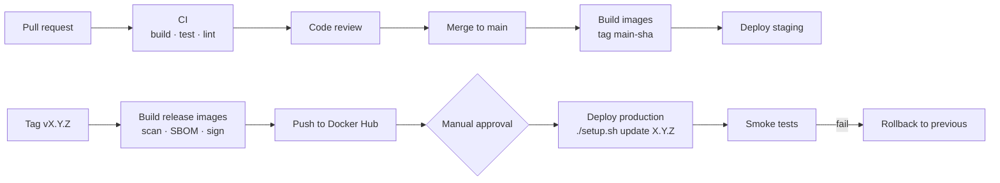

## Context

Version 1.1.0 is built and published manually (PAI-REL-010). The repository has no automated pipeline yet. This document defines the target pipeline, with ready-to-use GitHub Actions workflows, so that every change is tested and every release is reproducible, scanned and traceable.

### Goals

| Goal | Measure |
|---|---|
| Every pull request is verified | Backend tests, frontend lint and build, migration tests pass before merge |
| Releases are reproducible | Images built only by CI from a Git tag |
| Supply chain is visible | SBOM and vulnerability scan for every image |
| Deployments are safe | Staging first, manual approval for production, automatic health verification |
| Fast feedback | Pull request pipeline under 15 minutes |

## Pipeline overview



## Stages

| Stage | Trigger | Jobs | Blocking |
|---|---|---|---|
| 1. Verify | Pull request, push to any branch | Backend `./gradlew build` (unit + Testcontainers), frontend `npm ci`, `lint`, `build`, shell check of setup scripts | Yes |
| 2. Security checks | Pull request | Dependency review, CodeQL (Java, TypeScript), secret scanning | Yes for high severity |
| 3. Snapshot images | Push to `main` | Build all images, tag `main-<sha>`, push to a private registry or GHCR | No |
| 4. Staging deploy | After stage 3 | SSH to staging, set `PROCTOR_VERSION=main-<sha>`, `./setup.sh update`, smoke tests | No |
| 5. Release | Tag `v*.*.*` | Build images with version tags, Trivy scan, SBOM (Syft), sign (Cosign), push to Docker Hub, create GitHub release | Yes |
| 6. Production deploy | Manual approval on the release | SSH to production, backup, `./setup.sh update X.Y.Z`, smoke tests, automatic rollback on failure | Yes |
| 7. Native apps | Tag `v*.*.*` | Matrix build on Windows, macOS, Linux, Android; attach artifacts to the release | No |

## Workflow: continuous integration

`.github/workflows/ci.yml`

```yaml
name: CI
on:
  pull_request:
  push:
    branches: [main, v2]
permissions:
  contents: read
concurrency:
  group: ci-${{ github.ref }}
  cancel-in-progress: true
jobs:
  backend:
    runs-on: ubuntu-24.04
    timeout-minutes: 30
    steps:
      - uses: actions/checkout@v4
      - uses: actions/setup-java@v4
        with:
          distribution: temurin
          java-version: "21"
      - uses: gradle/actions/setup-gradle@v4
      - name: Build and test
        working-directory: backend
        run: ./gradlew build --no-daemon
      - name: Test reports
        if: always()
        uses: actions/upload-artifact@v4
        with:
          name: backend-test-reports
          path: backend/**/build/reports/tests/
  frontend:
    runs-on: ubuntu-24.04
    timeout-minutes: 15
    steps:
      - uses: actions/checkout@v4
      - uses: actions/setup-node@v4
        with:
          node-version: "22"
          cache: npm
          cache-dependency-path: frontend/package-lock.json
      - working-directory: frontend
        run: |
          npm ci
          npm run lint
          npm run build
  scripts:
    runs-on: ubuntu-24.04
    steps:
      - uses: actions/checkout@v4
      - run: shellcheck setup.sh docker/setup.sh clean-up.sh native-doctor.sh
```

Testcontainers uses the Docker engine that GitHub-hosted Ubuntu runners provide, so the integration tests run unchanged.

## Workflow: release

`.github/workflows/release.yml`

```yaml
name: Release
on:
  push:
    tags: ["v*.*.*"]
permissions:
  contents: write
  id-token: write
env:
  REPO: vishaltyagi807/proctor-ai
jobs:
  images:
    runs-on: ubuntu-24.04
    timeout-minutes: 90
    strategy:
      fail-fast: true
      matrix:
        include:
          - { service: db-migrator, target: service, context: backend }
          - { service: discovery-server, target: service, context: backend }
          - { service: api-gateway, target: service, context: backend }
          - { service: auth-service, target: service, context: backend }
          - { service: user-service, target: service, context: backend }
          - { service: department-service, target: service, context: backend }
          - { service: role-service, target: service, context: backend }
          - { service: complaint-service, target: service, context: backend }
          - { service: storage-service, target: service, context: backend }
          - { service: custom-field-service, target: service, context: backend }
          - { service: notification-service, target: service, context: backend }
          - { service: monitor-service, target: service, context: backend }
          - { service: face-service, target: face-service, context: backend }
          - { service: frontend, target: prod, context: frontend }
    steps:
      - uses: actions/checkout@v4
      - name: Fetch face models
        if: matrix.service == 'face-service'
        run: ./setup.sh models
      - uses: docker/setup-buildx-action@v3
      - uses: docker/login-action@v3
        with:
          username: ${{ secrets.DOCKERHUB_USERNAME }}
          password: ${{ secrets.DOCKERHUB_TOKEN }}
      - id: version
        run: echo "v=${GITHUB_REF_NAME#v}" >> "$GITHUB_OUTPUT"
      - uses: docker/build-push-action@v6
        with:
          context: ${{ matrix.context }}
          target: ${{ matrix.target }}
          build-args: |
            SERVICE=${{ matrix.service }}
            GRADLE_FLAGS=--no-build-cache
          tags: |
            ${{ env.REPO }}:${{ matrix.service }}-${{ steps.version.outputs.v }}
            ${{ env.REPO }}:${{ matrix.service }}-latest
          push: true
          sbom: true
          provenance: mode=max
          cache-from: type=gha,scope=${{ matrix.service }}
          cache-to: type=gha,mode=max,scope=${{ matrix.service }}
      - uses: aquasecurity/trivy-action@0.28.0
        with:
          image-ref: ${{ env.REPO }}:${{ matrix.service }}-${{ steps.version.outputs.v }}
          severity: CRITICAL,HIGH
          exit-code: "1"
          ignore-unfixed: true
  github-release:
    needs: images
    runs-on: ubuntu-24.04
    steps:
      - uses: actions/checkout@v4
      - uses: softprops/action-gh-release@v2
        with:
          generate_release_notes: true
```

> [!NOTE]
> The face-service image needs the ONNX models in `backend/face-service/models/`. `./setup.sh` downloads and verifies them during a normal run; the release job must run the same download step (shown as `./setup.sh models`, which should be added as a small sub-command that only fetches models) or restore them from a cache.

## Workflow: deployment

`.github/workflows/deploy.yml`

```yaml
name: Deploy
on:
  workflow_dispatch:
    inputs:
      version:
        description: Version to deploy, for example 1.2.0
        required: true
      environment:
        type: choice
        options: [staging, production]
jobs:
  deploy:
    runs-on: ubuntu-24.04
    environment: ${{ inputs.environment }}
    steps:
      - name: Backup and upgrade
        uses: appleboy/ssh-action@v1
        with:
          host: ${{ secrets.DEPLOY_HOST }}
          username: ${{ secrets.DEPLOY_USER }}
          key: ${{ secrets.DEPLOY_SSH_KEY }}
          script: |
            set -e
            sudo /usr/local/sbin/proctorai-backup.sh
            cd /opt/proctorai/docker
            echo "$(grep '^PROCTOR_VERSION=' .env || echo none)" > /tmp/proctorai-previous
            ./setup.sh update ${{ inputs.version }} --yes
      - name: Smoke test
        run: |
          for i in $(seq 1 30); do
            code=$(curl -s -o /dev/null -w '%{http_code}' -X POST "${{ vars.APP_URL }}/api/auth/refresh")
            [ "$code" = "401" ] && exit 0
            sleep 10
          done
          exit 1
```

The `production` GitHub environment requires approval from a maintainer and restricts the deploy secrets to protected tags. On smoke-test failure, an operator runs the rollback in PAI-REL-010 (or a follow-up job runs `./setup.sh update <previous>`).

## Secrets and environments

| Secret / variable | Scope | Purpose |
|---|---|---|
| `DOCKERHUB_USERNAME`, `DOCKERHUB_TOKEN` | Repository | Push images (token with write scope only) |
| `DEPLOY_HOST`, `DEPLOY_USER`, `DEPLOY_SSH_KEY` | Environment (`staging`, `production`) | SSH deployment; key restricted to the deploy user |
| `APP_URL` | Environment variable | Smoke test target |
| `APPLE_*`, `ANDROID_KEYSTORE_*`, `WINDOWS_CERT_*` | Environment `native-release` | Signing native apps |

Application secrets (`.env`) never enter CI; they stay on the servers.

## Quality gates

| Gate | Rule |
|---|---|
| Tests | All backend tests pass, including RLS and migration tests |
| Lint | No ESLint errors |
| Build | Frontend production build succeeds |
| Vulnerabilities | No unfixed CRITICAL or HIGH in images (Trivy) or dependencies (dependency review) |
| Review | At least one approving review; branch up to date with `main` |
| Migrations | Changes under `db/migration/` require review from a database owner (CODEOWNERS) |

## Branch protection

| Setting | `main` |
|---|---|
| Require pull request | Yes, 1 approval |
| Required checks | `backend`, `frontend`, `scripts`, CodeQL |
| Require linear history | Yes |
| Restrict force pushes and deletion | Yes |
| Require signed commits | Recommended |

## Implementation plan

| Step | Deliverable | Effort |
|---|---|---|
| 1 | Add `ci.yml`; enable branch protection | 0.5 day |
| 2 | Add a models-only sub-command to `setup.sh`; add `release.yml`; Docker Hub token | 1 day |
| 3 | Provision staging server; add `deploy.yml` with environments | 1 day |
| 4 | Enable CodeQL, Dependabot (Gradle, npm, Docker, Actions) and secret scanning | 0.5 day |
| 5 | Native app matrix builds with signing | 2 days |
| 6 | Image signing with Cosign and verification on servers | 1 day |
