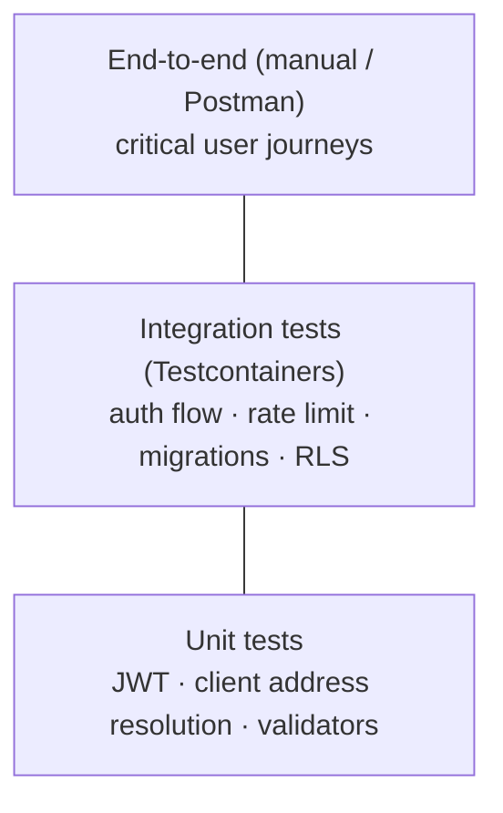

## Getting started

### Prerequisites

| Tool | Version | Needed for |
|---|---|---|
| Git | Any recent | Source control |
| Docker + Compose | 25+ / 2.21+ | Running the stack and the backend tests |
| Java (optional locally) | 21 | IDE support; builds run inside Docker or via the Gradle wrapper |
| Node.js | 20.19+ or 22.12+ | Frontend outside Docker, native apps |
| Rust | 1.90+ | Native apps (Tauri) |
| IDE | IntelliJ IDEA (backend), VS Code (frontend) | Lombok and MapStruct annotation processing must be enabled |

Minimum machine: 8 GB RAM (16 GB recommended) and 20 GB free disk.

### First run

```bash
git clone https://github.com/vishaltyagi807/Proctor-AI.git
cd Proctor-AI
./setup.sh
```

| Service | URL |
|---|---|
| Web app | `http://localhost:5173` |
| API gateway | `http://localhost:7050` |
| Service registry | `http://localhost:8761` (`proctor-discovery` / `DISCOVERY_PASSWORD` from `backend/.env`) |
| MinIO console | `http://localhost:9201` |

Sign in with `admin@college.com` / `admin123` (development only).

### Daily workflow

| Task | Command |
|---|---|
| Frontend change | Save; Vite reloads instantly |
| Backend change | `./setup.sh` (rebuilds only changed images) |
| Logs | `./setup.sh logs <service>` |
| Status | `./setup.sh status` |
| Stop | `./setup.sh stop` |
| Fresh database | `./setup.sh purge` then `./setup.sh` |
| Frontend outside Docker | `docker compose -f backend/docker-compose.yaml stop frontend && cd frontend && npm run dev` |
| API testing | Import `backend/postman/ProctorAI.postman_collection.json` and the environment file |
| Sample users | `backend/seed-data/users-bulk-import.csv` |

## Repository layout

| Path | Contents |
|---|---|
| `backend/build.gradle.kts`, `settings.gradle.kts` | Shared Gradle configuration (Java 21, Spring BOMs, Lombok, MapStruct) and module list |
| `backend/common-*` | Shared libraries (security, persistence, storage, notifications, custom fields, monitoring, DTOs) |
| `backend/*-service`, `api-gateway`, `discovery-server` | Deployable services |
| `backend/db-schema` | Flyway migrations |
| `backend/db-migrator` | Migration runner and database tests |
| `backend/test-support` | Testcontainers helpers (`TestDatabase`, `TestRedis`) |
| `backend/Dockerfile` | Multi-stage build for every backend image |
| `frontend/src/routes` | TanStack Router route definitions |
| `frontend/src/pages`, `components/<feature>` | Screens and feature components; `components/ui` holds shadcn/ui primitives |
| `frontend/src/lib` | API client, session, permissions, queries |
| `frontend/src/platform` | Web, desktop and mobile integration (Tauri plugins) |
| `frontend/src-tauri` | Native shell (Rust), icons and capabilities |
| `docker/` | Published-image deployment |
| `docs/` | This documentation set and its PDF build |

## Backend conventions

### Structure of a service

```
<service>/src/main/java/dev/varshit/proctor/<service>/
├── <Name>Application.java
├── controller/   REST endpoints, validation, HTTP status
├── dto/          request and response records
├── service/      interfaces and *Impl with business rules
├── repository/   interfaces and Sql* implementations
└── config/       service-specific configuration
```

### Rules

| Topic | Convention |
|---|---|
| Language | Java 21; records for DTOs; `var` where it improves clarity |
| Reactive | Return `Mono`/`Flux` end to end; never call `block()` in request paths |
| Data access | Explicit SQL through `SqlGateway`; parameters always bound (`:name`), never concatenated |
| Authorization | Rely on RLS; run request queries inside `SecureTransaction` so `auth.uid` is set. Do not duplicate permission logic in Java unless the database cannot express it |
| Validation | Bean Validation annotations on request records; mirror important limits in database constraints |
| Errors | Throw `common-lib` exceptions (`BadRequestException`, `NotFoundException`, …); never return stack traces |
| Configuration | `application.yaml` with `${ENV_VAR:default}`; add new variables to `.env.example`, the compose files and PAI-CFG-007 |
| Notifications | Publish through `NotificationPublisher`; never write to `notifications` directly from other services |
| Shared code | Belongs in a `common-*` module only when used by two or more services |
| Comments | Code should be self-explanatory; comments only where intent is not obvious and the maintainers ask for them |
| Formatting | Four-space indentation, IntelliJ default Java style, imports without wildcards |

### Adding an endpoint

1. Add request/response records in `dto/` with validation.
2. Add the method to the service interface and implementation.
3. Add the repository query; filter and paginate with `PagedQueryRunner` and `FieldSpec` maps.
4. If a new entity or permission is needed, add a migration (enum value, permissions, policies, grants).
5. Add a route to the gateway if the path prefix is new.
6. Update the Postman collection and PAI-API-003.

## Frontend conventions

| Topic | Convention |
|---|---|
| Language | TypeScript strict mode; no `any` in new code |
| Routing | TanStack Router route modules in `src/routes`; screens in `src/pages` |
| Data | TanStack Query for server state; query keys and API calls in `src/lib` |
| UI | shadcn/ui and Base UI primitives in `components/ui`; Tailwind CSS 4 tokens from `index.css` (`--primary`, `--brand`, …); no hard-coded colours |
| Permissions | Use the permission helpers in `src/lib` to show or hide actions; the server remains the authority |
| Platform | Native features only through `src/platform` so the web build stays free of Tauri calls |
| Accessibility | Labels on all inputs, keyboard navigation, visible focus, sufficient contrast in light and dark themes |
| Linting | `npm run lint` must pass |

## Test strategy

### Test pyramid



### Existing automated tests

| Test | Module | Covers |
|---|---|---|
| `JwtTokenServiceTest` | common-security | Token issue/verify, expiry, secret length |
| `ClientAddressResolverTest`, `ClientAddressFilterTest` | api-gateway | Trusted proxy handling of `X-Forwarded-For` |
| `LoginRateLimitIntegrationTest` | api-gateway | Redis token bucket on `/auth/login` |
| `AuthFlowIntegrationTest` | auth-service | Login, refresh rotation, reuse detection, logout, lockout |
| `MigrationTest` | db-migrator | All migrations apply on an empty database; legacy baseline |
| `DbMigratorApplicationTest` | db-migrator | Migrator start-up with placeholders |
| `RowLevelSecurityTest` | db-migrator | Policies per role and scope, triggers and invariants |

### Running tests

```bash
cd backend
./gradlew build                     # everything; Docker must be running
./gradlew :auth-service:test        # one module
./gradlew :db-migrator:test --tests '*RowLevelSecurityTest'
```

Reports are written to `backend/<module>/build/reports/tests/test/index.html`.

### What to test when you change…

| Change | Required tests |
|---|---|
| A migration, policy, trigger or security function | Extend `RowLevelSecurityTest` with allowed and denied cases for each affected role/scope; `MigrationTest` must pass |
| Authentication or session logic | Extend `AuthFlowIntegrationTest` |
| Gateway filters or routes | Unit test plus an integration test where Redis or routing is involved |
| A service business rule | Unit test of the service with a mocked repository, or an integration test with Testcontainers |
| A new endpoint | Postman request with example; integration test for permission boundaries |
| Frontend behaviour | Lint and build; manual check in light/dark themes and at phone width |

### Recommended additions

| Area | Proposal |
|---|---|
| Frontend unit tests | Vitest + Testing Library for `src/lib` and complex components |
| End-to-end | Playwright suite for sign-in, complaint lifecycle, file upload, face enrollment |
| API contract | Generate an OpenAPI document with springdoc and validate in CI |
| Load | k6 scripts for sign-in, complaint listing and recognition |
| Coverage | JaCoCo report with a minimum threshold on `common-*` modules |

### Manual acceptance checklist

| # | Scenario | Expected |
|---|---|---|
| 1 | Student files a complaint with an attachment | Appears as `pending`; staff of the department notified |
| 2 | Student edits the complaint after it is reviewed | Rejected with "complaint is already being processed" |
| 3 | Teacher of another department opens it | Not visible |
| 4 | Teacher resolves it with a note | History shows the change; student notified in real time |
| 5 | Internal comment by staff | Not visible to the student |
| 6 | Admin creates a role with permissions it holds | Succeeds; granting a permission it does not hold fails |
| 7 | Bulk import of the sample CSV | Progress shown; users created with roles and departments |
| 8 | Face enroll then recognise | Match shown; audit records both events |
| 9 | Self-enroll twice | Second attempt blocked until unlocked |
| 10 | Eleven wrong passwords | Account locked; correct password rejected until lockout ends |

## Git workflow

1. Create a branch from the integration branch: `feature/<short-name>` or `fix/<short-name>`.
2. Commit in small, focused steps using Conventional Commits:

| Type | Use |
|---|---|
| `feat:` | New feature |
| `fix:` | Bug fix |
| `docs:` | Documentation only |
| `refactor:` | Code change without behaviour change |
| `test:` | Tests only |
| `chore:` / `build:` / `ci:` | Tooling, dependencies, pipelines |

3. Keep the branch up to date with `main`; resolve conflicts locally.
4. Open a pull request using the checklist below.

### Pull request checklist

| # | Item |
|---|---|
| 1 | Description explains *what* and *why*; links the issue |
| 2 | `./gradlew build` and `npm run lint && npm run build` pass |
| 3 | New or changed behaviour has tests |
| 4 | Migrations follow PAI-DB-004 and are never edits of released files |
| 5 | New configuration added to `.env.example`, compose files and PAI-CFG-007 |
| 6 | API changes reflected in the Postman collection and PAI-API-003 |
| 7 | No secrets, `.env` files or generated artefacts committed |
| 8 | Screenshots for UI changes (light and dark) |

### Review guidelines

Reviewers check correctness, security (especially RLS and permission changes), performance of new queries (indexes, pagination), error handling, naming and test quality. Approve only when you would be comfortable operating the change in production.

## Documentation

The documentation in `docs/` is written in Markdown (`docs/src/*.md`) and rendered to themed PDFs:

```bash
cd docs
npm install
npm run build          # writes docs/pdf/*.pdf and the combined handbook
```

Update the relevant document in the same pull request as the code change.
